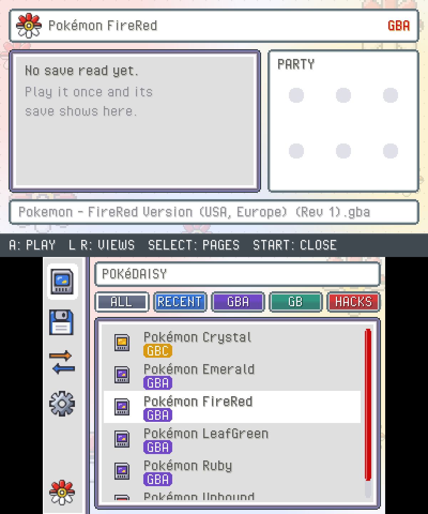
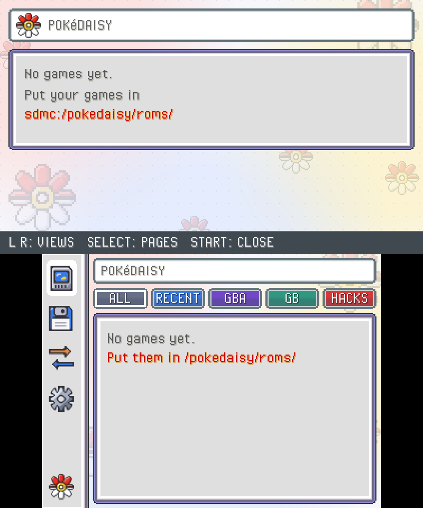
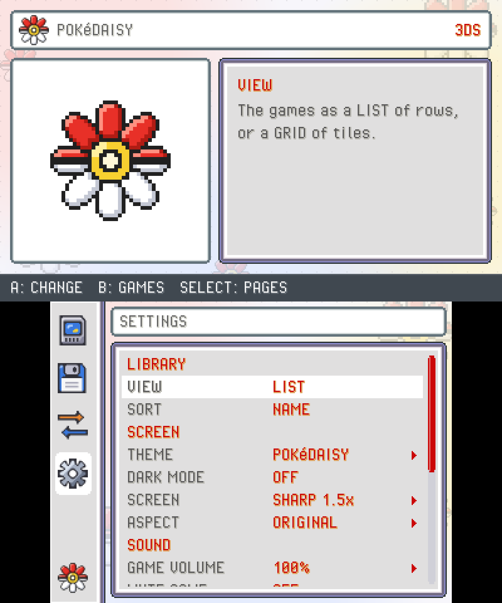

<!-- Made from docs/manual/translations/pt/3ds.md by website/scripts/install-guides.mjs: edit that page, not this file. -->

# Instalar numa Nintendo 3DS

*Instale a aplicação homebrew PokeDaisy numa 3DS passo a passo, junte os seus jogos e jogos guardados e ligue o som.*

[English](INSTALL.md) · [日本語](INSTALL.ja.md) · [한국어](INSTALL.ko.md) · [Français](INSTALL.fr.md) · [Deutsch](INSTALL.de.md) · [Italiano](INSTALL.it.md) · [Español](INSTALL.es.md) · [Português (Brasil)](INSTALL.pt-br.md) · **Português (Portugal)**

Também no site: https://pokedaisy.com/pt/docs/3ds/

O PokeDaisy também corre na Nintendo 3DS, como aplicação homebrew: o seu jogo corre no ecrã superior e o companheiro fica no ecrã tátil, com a sua própria biblioteca de jogos, um editor de jogos guardados e trocas entre jogos guardados. Esta página leva-o de uma consola com firmware personalizado até ao seu primeiro jogo.

> [!NOTE]
> A versão para 3DS é uma pré-visualização inicial. Foi feita para a **New Nintendo 3DS, New Nintendo 3DS XL e New Nintendo 2DS XL**. Uma Nintendo 3DS, 3DS XL ou 2DS original pode abri-la, mas pode ficar lenta. Os menus estão em inglês, para já.

## O que precisa

- **Uma 3DS com firmware personalizado (Luma3DS) e o Homebrew Launcher.** Se a sua consola ainda não os tem, siga o [3ds.hacks.guide](https://3ds.hacks.guide/). É o guia da comunidade, atualizado para cada consola e versão do sistema, e prepara tudo aquilo de que esta página precisa. Volte aqui quando terminar.
- **O cartão SD** e um computador que o consiga ler (ou uma aplicação de FTP na 3DS, se preferir não tirar o cartão).
- **Os seus próprios jogos.** O PokeDaisy não traz nenhum jogo. Use ROMs que extraiu dos cartuchos que tem: ficheiros `.gba`, `.gb` ou `.gbc`.

## Passo 1: obter a aplicação

1. No computador, abra a [página de versões do PokeDaisy](https://github.com/lidor30/pokedaisy/releases).
2. Na versão mais recente que tenha um ficheiro para 3DS, transfira `pokedaisy.3dsx`.

## Passo 2: copiá-la para o cartão SD

1. Desligue a 3DS e coloque o cartão SD no computador.
2. Abra a pasta `3ds` na raiz do cartão. Foi criada quando instalou o firmware personalizado; se não estiver lá, crie-a.
3. Copie `pokedaisy.3dsx` para dentro dela, para que o cartão tenha `sdmc:/3ds/pokedaisy.3dsx`.

`sdmc:/` é o nome que a 3DS dá à raiz do cartão SD: no seu computador, `sdmc:/3ds/` é apenas a pasta `3ds` do cartão.

## Passo 3: juntar os seus jogos e jogos guardados

1. Na raiz do cartão, crie uma pasta `pokedaisy` e, dentro dela, uma pasta `roms`: `sdmc:/pokedaisy/roms/`. (O PokeDaisy cria as duas na primeira vez que abre, se preferir abri-lo uma vez antes.)
2. Copie os seus jogos para `roms`. Coloque-os diretamente na pasta, não em subpastas, e descomprima-os antes: na 3DS, o PokeDaisy só lê ficheiros `.gba`, `.gb` e `.gbc` soltos.
3. Traz um jogo guardado de outro emulador? Coloque-o em `roms` ao lado do jogo, com o mesmo nome e `.sav` no fim: `Pokemon Emerald.gba` lê `Pokemon Emerald.sav`. Um jogo guardado do RetroArch termina em `.srm`: mude o nome para `.sav`. Guarde também uma cópia no computador, pelo sim pelo não.

Sem jogo guardado, o jogo começa do zero e o PokeDaisy cria o `.sav` na mesma pasta na primeira vez que guardar no jogo.

## Passo 4: ligar o som

O homebrew da 3DS só consegue tocar som depois de o firmware de áudio da consola ser copiado para o cartão SD. Só tem de o fazer uma vez:

1. Volte a colocar o cartão SD, ligue a 3DS, mantenha **L** premido e prima **para baixo** na cruz direcional e **SELECT** para abrir o menu Rosalina.
2. Escolha **Miscellaneous options** e depois **Dump DSP firmware**.
3. Prima **B** até o menu fechar.

Isto grava `sdmc:/3ds/dspfirm.cdc`. Sem ele, os jogos correm sem som. Se já o fez antes para outra aplicação, não há nada a fazer.

## Passo 5: abrir o PokeDaisy

1. Abra o Homebrew Launcher. Numa consola preparada com o 3ds.hacks.guide, abre a partir da aplicação de jogo por transferência (Download Play).
2. Escolha **PokeDaisy** na lista.

A biblioteca abre: o ecrã tátil lista os seus jogos e o ecrã superior mostra o que está sob o cursor, com o seu jogador, o tempo de jogo e a equipa depois de o ter jogado. Mova-se com a cruz direcional ou toque num jogo, e prima **A** para jogar.

Se a biblioteca disser **No games yet**, verifique se os jogos estão diretamente em `sdmc:/pokedaisy/roms/` e terminam em `.gba`, `.gb` ou `.gbc`.

## Orientar-se

| Botão | O que faz |
| --- | --- |
| **A** | Jogar o jogo sob o cursor |
| **L** / **R** | Mudar as vistas da biblioteca: `ALL`, `RECENT`, `GBA`, `GB`, `HACKS` |
| **SELECT** | A página seguinte: jogos, `SAVE EDITOR`, `TRADE SAVES`, `SETTINGS` |
| **START** | Fechar o PokeDaisy e voltar ao Homebrew Launcher |

Durante o jogo, os botões da GBA são os mesmos da 3DS (o botão deslizante funciona como a cruz direcional) e o ecrã tátil é o companheiro. Mais alguns:

| Botão | O que faz |
| --- | --- |
| **Y** | O menu rápido: PC, `FLY`, a bicicleta, estados guardados, avanço rápido e mais |
| **X** | No mapa, passar os botões para o companheiro (**X** outra vez devolve-os ao jogo) |
| **ZR** | Avanço rápido enquanto o mantiver premido (New 3DS) |
| **ZL** | O separador anterior do companheiro (New 3DS) |

Para sair de um jogo, use `CLOSE GAME` no fim das `SETTINGS` do companheiro. O botão **HOME** e fechar a consola também funcionam.

## Que jogos funcionam

Qualquer jogo de Game Boy, Game Boy Color ou Game Boy Advance corre. O companheiro lê os jogos que o PokeDaisy conhece no Android: FireRed, LeafGreen, Ruby, Sapphire e Emerald, Red, Blue, Yellow, Gold, Silver e Crystal, e muitos hacks de ROM ([Jogos compatíveis](https://pokedaisy.com/docs/supported-games/) tem a lista). Os jogos de DS não correm na versão para 3DS.

## Onde fica cada coisa no cartão SD

| Caminho | O que lá está |
| --- | --- |
| `sdmc:/3ds/pokedaisy.3dsx` | A aplicação |
| `sdmc:/3ds/dspfirm.cdc` | O firmware de áudio (passo 4) |
| `sdmc:/pokedaisy/roms/` | Os seus jogos, e o `.sav` de cada um ao lado |
| `sdmc:/pokedaisy/roms/pokedaisy-backups/` | Uma cópia de cada jogo guardado antes de cada arranque, os 10 mais recentes por jogo |
| `sdmc:/pokedaisy/states/` | Os estados guardados |
| `sdmc:/pokedaisy/cheats/` | Os cheats, um ficheiro por jogo |
| `sdmc:/pokedaisy/settings.ini` | As suas definições |
| `sdmc:/pokedaisy/log.txt` | O que o último arranque fez: anexe-o quando comunicar um erro |

## Atualizar

Transfira o `pokedaisy.3dsx` novo e copie-o por cima do antigo em `sdmc:/3ds/`. Os seus jogos, jogos guardados, estados e definições estão todos em `sdmc:/pokedaisy/` e ficam como estão.

## Se algo correr mal

- **Sem som:** falta `sdmc:/3ds/dspfirm.cdc`. Faça o passo 4.
- **O PokeDaisy não aparece no Homebrew Launcher:** o ficheiro tem de estar em `sdmc:/3ds/` e terminar em `.3dsx`.
- **Um jogo não aparece na lista:** tem de estar diretamente em `sdmc:/pokedaisy/roms/`, não numa pasta lá dentro e não comprimido.
- **O meu jogo guardado não carregou:** precisa de ter exatamente o nome do jogo com `.sav` no fim. Cada arranque copia primeiro o jogo guardado para `sdmc:/pokedaisy/roms/pokedaisy-backups/`, por isso tem lá uma cópia mais antiga se precisar.
- **Está lento:** uma 3DS ou 2DS original é mais lenta do que os modelos New. Nas `SETTINGS` da biblioteca, mude `SCREEN` para `PIXEL 1x`, o modo mais leve.

Ainda com problemas? [Diga-nos](https://pokedaisy.com/pt/feedback/#bug) e anexe `sdmc:/pokedaisy/log.txt`.
