

<h3>Pokémon, played better. Game Boy to DS, with a live companion, a widescreen overworld, a HUD and quick menu, and every chore one button away.</h3>

  
  
  
  

  <strong><a href="#download-and-install">Download</a></strong>
  · <strong><a href="#the-companion">Features</a></strong>
  · <strong><a href="#supported-games">Supported games</a></strong>
  · <strong><a href="https://pokedaisy.com/docs/">Manual</a></strong>
  · <strong><a href="https://pokedaisy.com/feedback/#bug">Report a problem</a></strong>

PokeDaisy plays Game Boy, Game Boy Color, GBA and Nintendo DS games on Android handhelds, made for the Pokemon games
from Red to Black 2 and White 2 and dozens of ROM hacks. Next to the game runs a live companion that reads it as you
play: your party, bag, map, battle matchups, Pokedex and a spoiler-free guide, drawn in the game's own menu style. On
a dual-screen handheld it gets the bottom screen; on one screen it opens over the game.

  
  
  

## The companion

Every picture here is the real app.

<table>
  <tr>
    <td width="33%">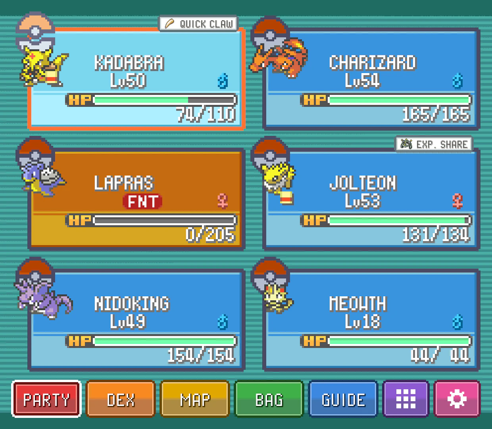</td>
    <td width="33%">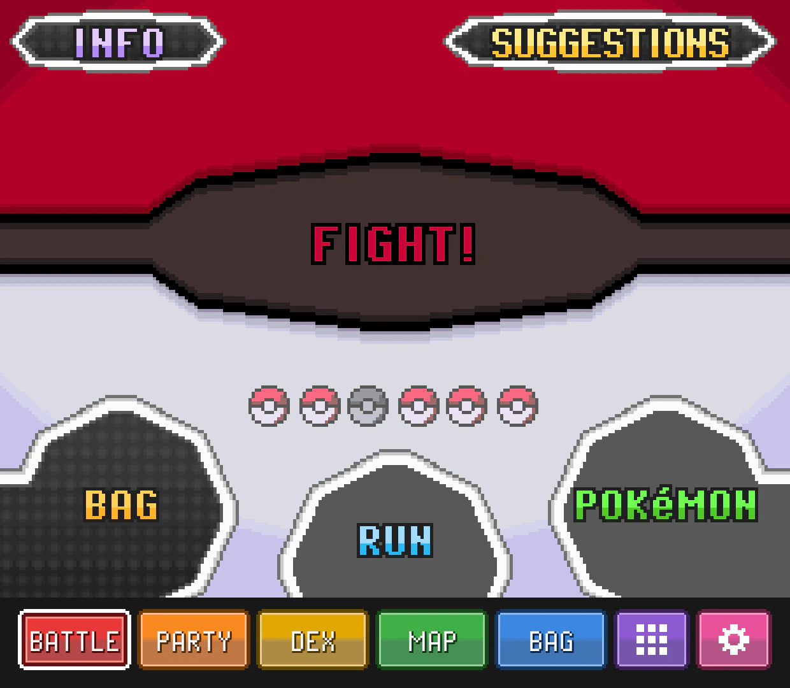</td>
    <td width="33%">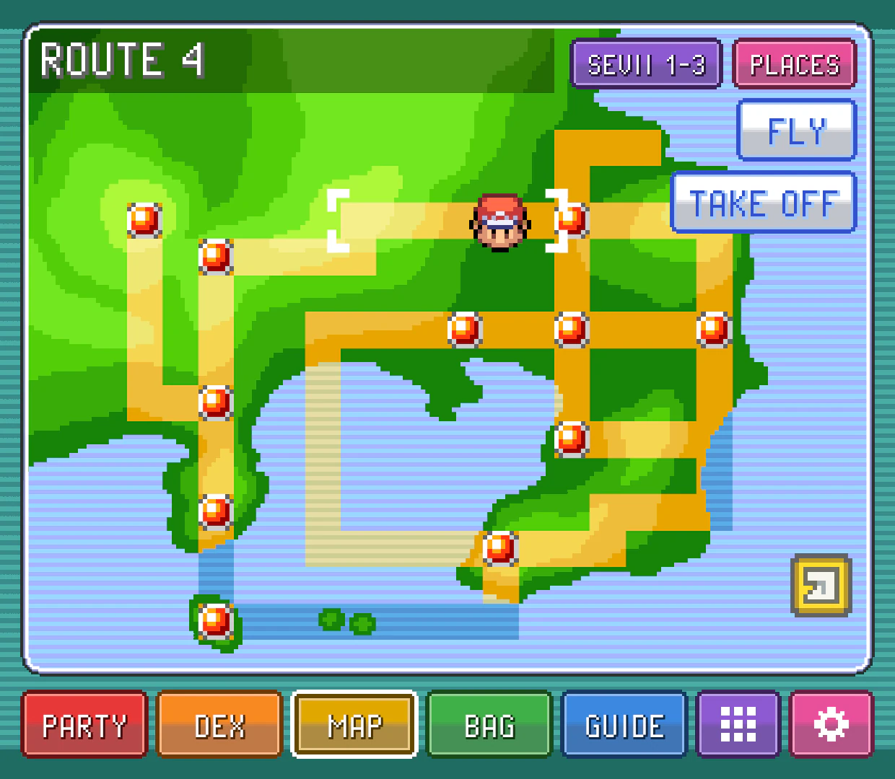</td>
  </tr>
  <tr>
    <td><b>PARTY</b>: your team in the game's own party screen. Tap one for stats, moves, IVs / EVs and what to learn.</td>
    <td><b>BATTLE</b>: opens by itself. Every matchup, the foe's whole team, the best pick, and buttons that play the turn (your last ball in one tap too).</td>
    <td><b>MAP</b>: the region map with you on it, every place searchable, FLY and TAKE OFF.</td>
  </tr>
  <tr>
    <td>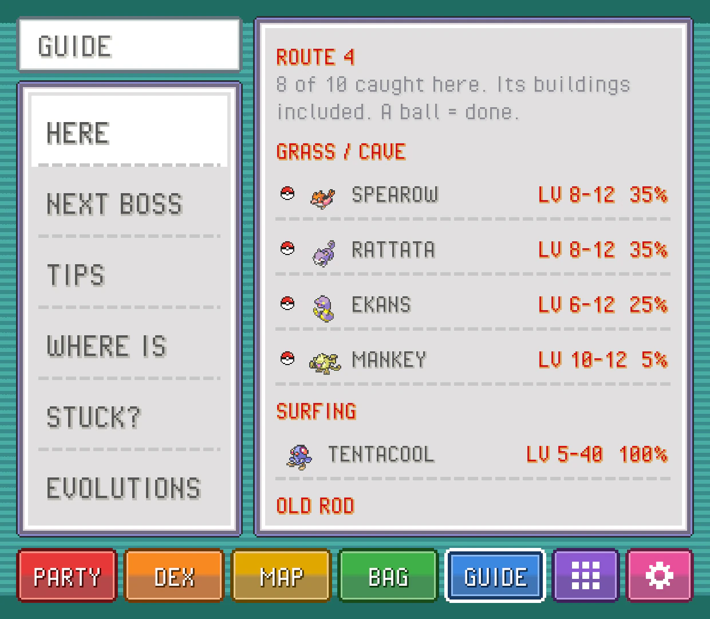</td>
    <td>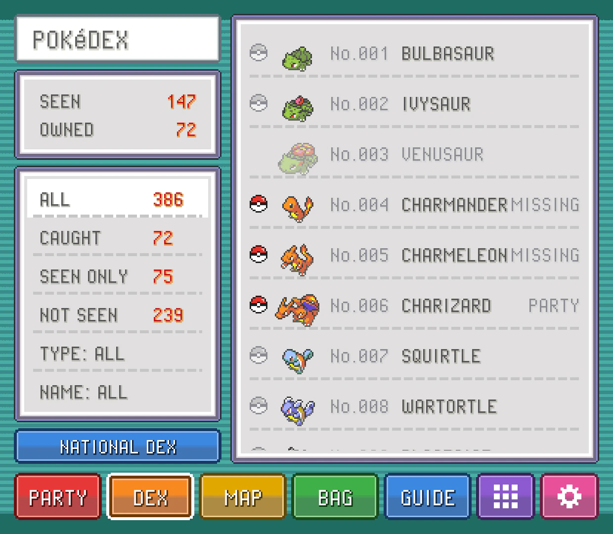</td>
    <td>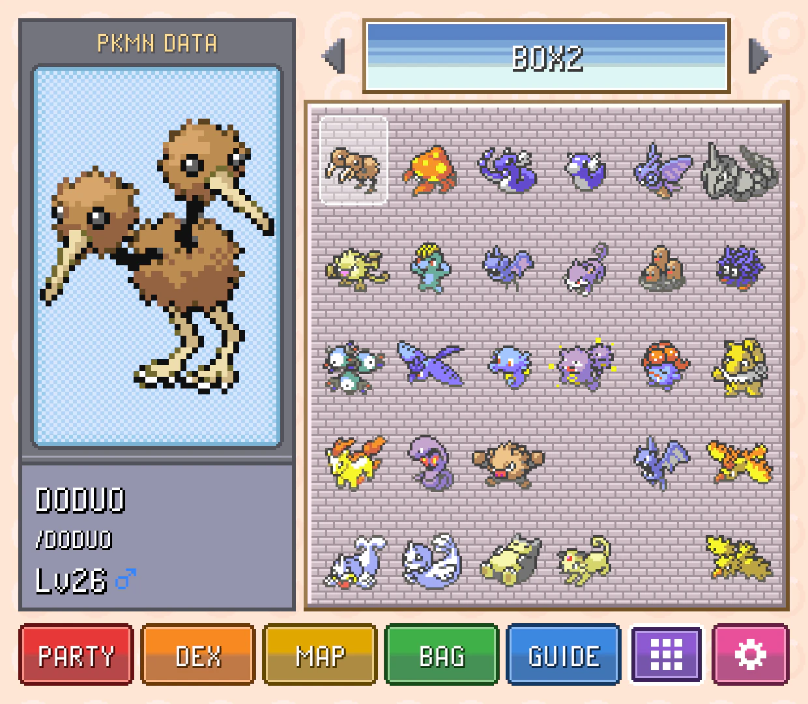</td>
  </tr>
  <tr>
    <td><b>GUIDE</b>: hints first, answers on a second tap. What's in this area, the next boss's team, a STUCK? page.</td>
    <td><b>DEX</b>: seen and caught, full entries, evolutions, where to catch each one, the moves it learns.</td>
    <td><b>BOXES</b>: your PC's boxes, laid out like the game's. Withdraw and deposit without a PC in FireRed, LeafGreen and Emerald.</td>
  </tr>
</table>

Also **BAG** (use and give items), **NUZLOCKE** (keeps score of a run), **CARD**, **STATES** (10 save-state slots) and
**ACHIEVEMENTS** (RetroAchievements). You pick which tabs sit on the bar.

## On the game screen

<table>
  <tr>
    <td width="50%">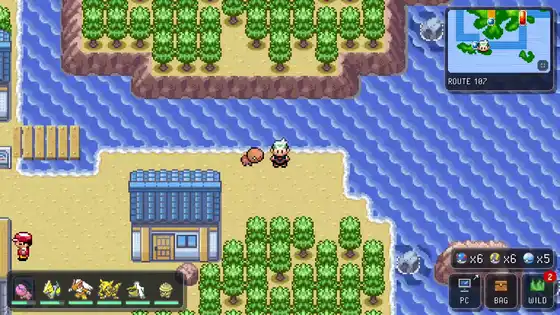</td>
    <td width="50%">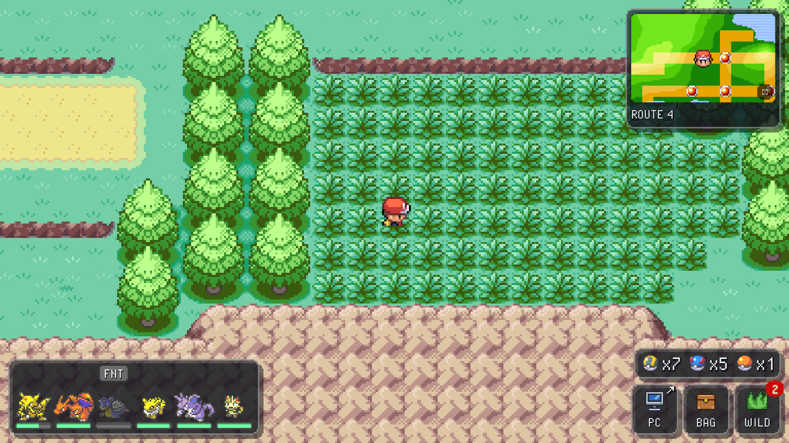</td>
  </tr>
  <tr>
    <td><b>QUICK MENU</b> (L3) and the <b>HUD</b>: PC, FLY, TAKE OFF, BIKE, ROD and fast-forward from one ring; the wild Pokemon here, your bag and the map a tap away on the game.</td>
    <td><b>EXPAND + HUD</b>: the overworld drawn past the GBA's edges to fill a wide screen, with your party, a minimap and your bag in the corners.</td>
  </tr>
</table>

EXPAND works in every Gen 3 game, many hacks and the Game Boy's Yellow and Crystal:

<table>
  <tr>
    <td width="33%">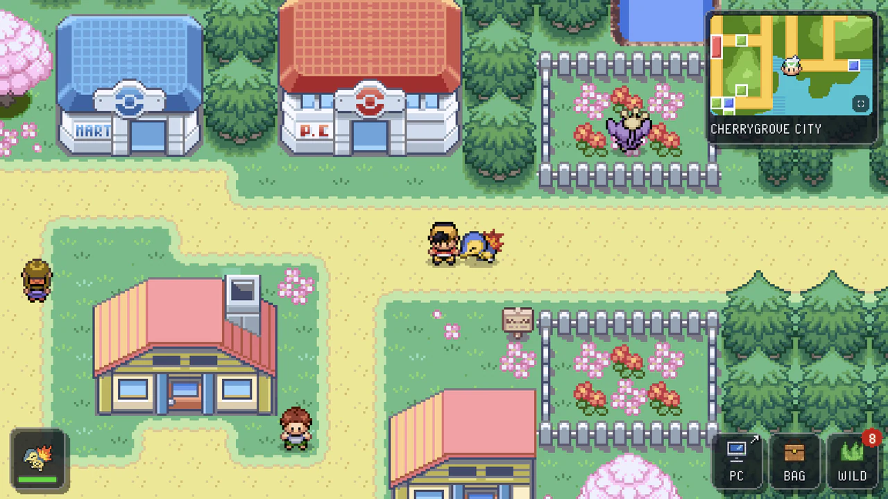 SoulGold</td>
    <td width="33%">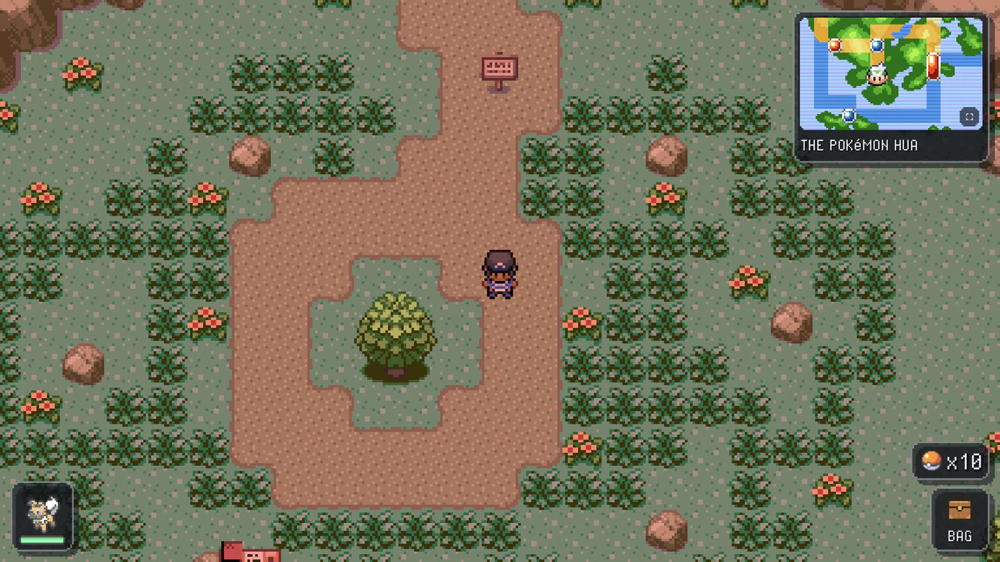 Emerald Rogue</td>
    <td width="33%">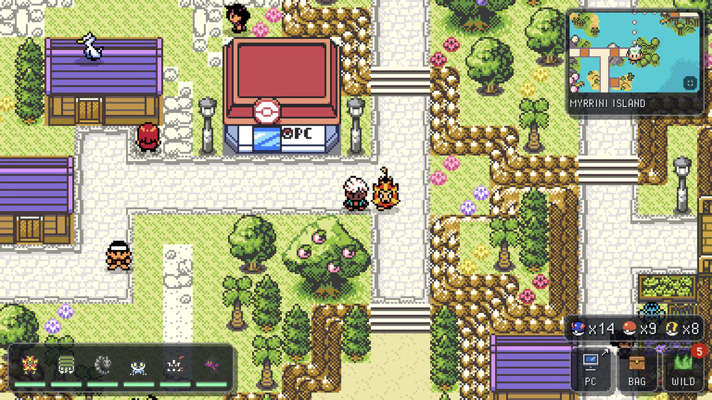 Lazarus</td>
  </tr>
  <tr>
    <td>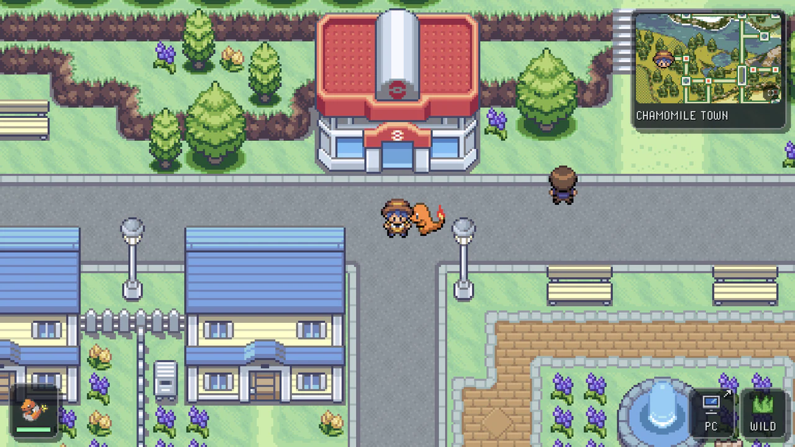 Monomyth</td>
    <td>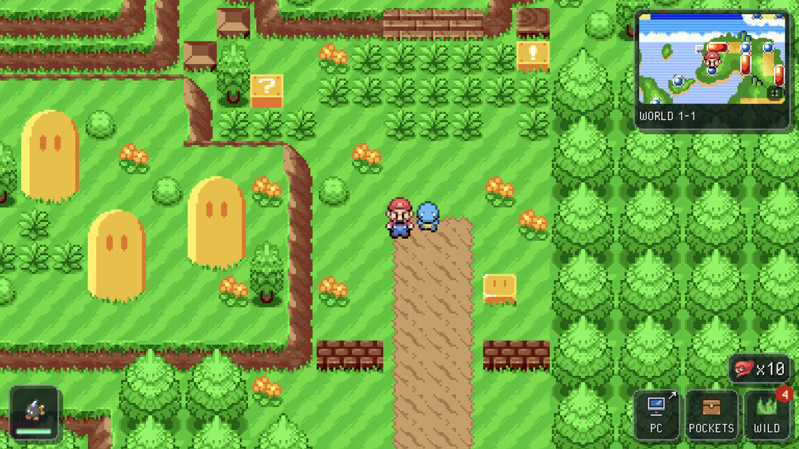 Super Mariomon</td>
    <td>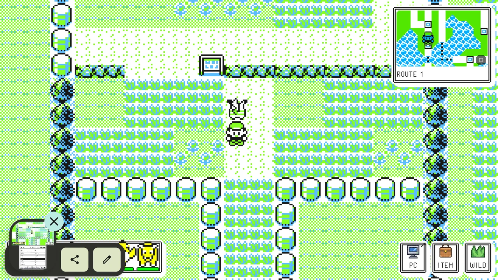 Yellow (Game Boy)</td>
  </tr>
</table>

## Fly anywhere, ride anything

<table>
  <tr>
    <td width="60%">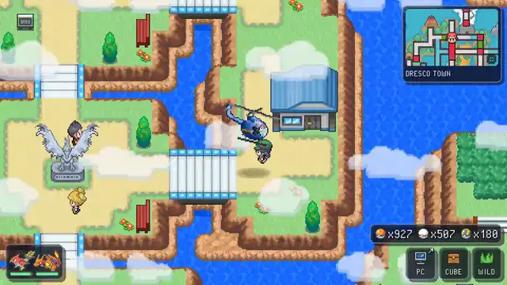</td>
    <td width="40%">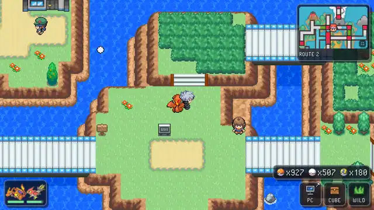</td>
  </tr>
  <tr>
    <td><b>FREE FLIGHT + FLY ON</b>: take off and fly anywhere over the map, on your Pokemon's bird or in a helicopter, plane, balloon or zeppelin.</td>
    <td><b>MAKEOVER</b>: your lead Pokemon follows you, play as another game's hero, day and night tints, a motorcycle for the bike.</td>
  </tr>
</table>

## And more

- **Fast-forward** that slows down in menus, with music that keeps its tempo. Slow motion, rewind, turbo, save states,
  a shiny alert that stops it all for a shiny, and a retry for a lost trainer battle.
- **Less walking back**: PC anywhere, FLY from the map, the Pokemon Center's services on any summary, wild encounters off,
  reusable TMs, field moves without HMs, an EXP share for the whole party, a level cap at the next boss's top level,
  a keep-away spray that refills itself, no low-health beep, no poison damage while walking, auto-run, instant text.
- **Shaders** (LCD, scanlines, CRT, GBA colours, edge smoothing), themes, dark mode, overlays.
- **Controls**: remap everything, touch controls you lay out yourself (or a Delta skin), any controller.
- **DS games**: the touch screen on the bottom screen, or in five layouts on one, upscaled 2x to 8x.
- **Tools**: link play (two to four games on one cable), a save editor (with what your Pokédex is missing), save trades (and trade and back for trade evolutions), Pal Park from a GBA game to a DS one, Poké Transfer on to Black and White, one collection of every save's Pokémon, BPS patching.
- **Your files**: standard `.sav` / `.srm` saves shared with RetroArch and mGBA, a backup every start, zipped ROMs,
  launching from ES-DE, Cocoon and iiSU ([iiSU](docs/iisu/README.md), [ES-DE](docs/es-de/README.md) setup).
- **Nine languages**: English, Japanese, Korean, French, German, Italian, Spanish and both Portugueses.

Everything is explained in the [manual](https://pokedaisy.com/docs/).

## Devices

| Device                     | Status                                                         |
| -------------------------- | -------------------------------------------------------------- |
| AYN Thor                   | Tested, made for it                                            |
| Retroid Pocket Duo Lite    | Supported, with its own 4:3 layout                             |
| Retroid Pocket Duo         | Should work, not yet tested on real hardware                   |
| Anbernic RG DS             | Should work, not yet tested on real hardware                   |
| Retroid Pocket 6           | Single screen: tested                                          |
| Other one-screen handhelds | Should work, held sideways like the Pocket 6                   |
| Android phones (portrait)  | Should work, checked in screenshots only                       |
| A phone cast to a TV       | Should work: the game on the TV, the companion on the phone    |

Any Android 8.0+ device runs the games.

## Download and install

  
  
  
  
  

Every file is on the [latest release](https://github.com/lidor30/pokedaisy/releases/latest). **No games are included:**
use your own legally dumped ROMs.

### Android

Android 8.0 or newer: dual-screen handhelds, one-screen handhelds and phones.
[**Download the APK**](https://github.com/lidor30/pokedaisy/releases/latest) (`PokeDaisy-<version>.apk`) on the
device and open it. A short setup links your ROMs folders, picks where saves go and can add cover art. The app then
offers each new version by itself. Guide: [Install and first setup](https://pokedaisy.com/docs/install/).

### Linux

| For | Download |
| --- | --- |
| Steam Deck and Linux PCs | [`pokedaisy-linux-x86_64.zip`](https://github.com/lidor30/pokedaisy/releases/latest/download/pokedaisy-linux-x86_64.zip) |
| TrimUI handhelds (CrossMix, NextUI) | [`pokedaisy-linux-aarch64.zip`](https://github.com/lidor30/pokedaisy/releases/latest/download/pokedaisy-linux-aarch64.zip) |
| PortMaster handhelds (ROCKNIX, Knulli, muOS) | [`pokedaisy-portmaster-aarch64.zip`](https://github.com/lidor30/pokedaisy/releases/latest/download/pokedaisy-portmaster-aarch64.zip) |
| TrimUI Brick on NXRedux | [`PokeDaisy-NXRedux.zip`](https://github.com/lidor30/pokedaisy/releases/latest/download/PokeDaisy-NXRedux.zip) |
| Cores for RetroArch, on a PC | [`pokedaisy-libretro-x86_64.zip`](https://github.com/lidor30/pokedaisy/releases/latest/download/pokedaisy-libretro-x86_64.zip) |
| Cores for RetroArch, on an ARM handheld | [`pokedaisy-libretro-aarch64.zip`](https://github.com/lidor30/pokedaisy/releases/latest/download/pokedaisy-libretro-aarch64.zip) |

Guide: [Install on Linux, Steam Deck and handhelds](https://pokedaisy.com/docs/linux-install/).

### Nintendo 3DS

An early preview, for a 3DS with custom firmware and the Homebrew Launcher:
[`pokedaisy.3dsx`](https://github.com/lidor30/pokedaisy/releases/latest/download/pokedaisy.3dsx). Guide: [Install on a Nintendo 3DS](https://pokedaisy.com/docs/3ds/).

### Windows and iOS

In the works.

## Supported games

Any Game Boy, Game Boy Color, GBA or DS game plays. The companion knows Red to Crystal, FireRed, LeafGreen, Emerald,
Ruby and Sapphire in every language, Platinum, HeartGold, SoulSilver, Black, White, Black 2 and White 2, and dozens of
ROM hacks, **in the exact version listed** (another version shows a "not supported" notice). Drop your ROM into the
[ROM check](https://pokedaisy.com/#check) to see what works with it: it never leaves your browser.

<strong>The full list, game by game</strong> (✅ works · ◐ partly · — not yet)

| Game                           | Version                    | Party | Bag | Battle | Map |   Dex   | Guide |
| ------------------------------ | -------------------------- | :---: | :-: | :----: | :-: | :-----: | :---: |
| Red / Blue (GB)                | USA/Europe                 |  ✅   | ✅  |   ◐    | ✅  |   ✅    |  ✅   |
| Red / Blue (GB)                | DE (Rote Edition / Blaue Edition) |  ✅   | ✅  |   ◐    | ✅  |   ✅    |  ✅   |
| PureRed / PureBlue (GB)        | 2.7.6                      |  ✅   | ✅  |   ◐    | ✅  |   ✅    |   —   |
| Yellow (GB)                    | USA/Europe                 |  ✅   | ✅  |   ◐    | ✅  |   ✅    |  ✅   |
| Yellow (GB)                    | DE / FR / IT / ES          |  ✅   | ✅  |   ◐    | ✅  |   ✅    |  ✅   |
| Yellow Legacy (GB)             | 1.0.10                     |  ✅   | ✅  |   ◐    | ✅  |   ✅    |   ✅   |
| Brown (GB)                     | 6.0.1, 6.1.2               |  ✅   | ✅  |   ◐    | ✅  |   ✅    |   —   |
| Gold / Silver (GBC)            | USA/Europe                 |  ✅   | ✅  |   ◐    | ✅  |   ✅    |   —   |
| Gold / Silver (GBC)            | DE (Goldene Edition, Silberne Edition) |  ✅   | ✅  |   ◐    | ✅  |   ✅    |   —   |
| Crystal (GBC)                  | USA, USA/Europe rev 1, AU  |  ✅   | ✅  |   ◐    | ✅  |   ✅    |  ✅   |
| Crystal (GBC)                  | DE (Kristall)              |  ✅   | ✅  |   ◐    | ✅  |   ✅    |  ✅   |
| Crystal Legacy (GBC)           | 1.3.1                      |  ✅   | ✅  |   ◐    | ✅  |   ✅    |   ✅   |
| Crystal Clear (GBC)            | 2.5.11, 2.6.0 (4 builds)   |  ✅   | ✅  |   ◐    | ✅  |   ✅    |   —   |
| Prism (GBC)                    | 0.95 build 254             |  ✅   | ✅  |   ◐    | ✅  |   ✅    |   —   |
| Polished Crystal (GBC)         | 3.2.0-3.2.3 (16 builds)    |  ✅   | ✅  |   ◐    | ✅  |   ✅    |  ✅   |
| FireRed                        | USA/Europe, rev 0 and 1    |  ✅   | ✅  |   ✅   | ✅  |   ✅    |  ✅   |
| FireRed                        | ES / DE / FR / IT / JP     |  ✅   | ✅  |   ✅   | ✅  |   ✅    |  ✅   |
| LeafGreen                      | USA/Europe, rev 0 and 1    |  ✅   | ✅  |   ◐    | ✅  |   ✅    |  ✅   |
| LeafGreen                      | ES / DE / FR / IT / JP     |  ✅   | ✅  |   ◐    | ✅  |   ✅    |  ✅   |
| Emerald                        | USA/Europe                 |  ✅   | ✅  |   ✅   | ✅  |   ✅    |  ✅   |
| Emerald                        | ES / DE / FR / IT / JP     |  ✅   | ✅  |   ✅   | ✅  |   ✅    |  ✅   |
| FireRed / Emerald, randomized  | UPR ZX 4.6.1, USA/Europe   |  ✅   | ✅  |   ✅   | ✅  |   ✅    |   ◐   |
| Ruby                           | USA, rev 0, 1 and 2        |  ✅   | ✅  |   ◐    | ✅  |   ✅    |  ✅   |
| Ruby                           | ES/DE/FR/IT/JP, rev 0-1    |  ✅   | ✅  |   ◐    | ✅  |   ✅    |  ✅   |
| Sapphire                       | USA, rev 0, 1 and 2        |  ✅   | ✅  |   ◐    | ✅  |   ✅    |  ✅   |
| Sapphire                       | ES/DE/FR/IT/JP, rev 0-1    |  ✅   | ✅  |   ◐    | ✅  |   ✅    |  ✅   |
| Platinum (DS)                  | USA rev 1, FR/ES rev 0     |  ✅   | ✅  |   ◐    | ✅  |   ✅    |  ✅   |
| HeartGold (DS)                 | USA, EU, every language    |  ✅   | ✅  |   —    | ✅  |   ✅    |  ✅   |
| SoulSilver (DS)                | USA, EU, every language    |  ✅   | ✅  |   —    | ✅  |   ✅    |  ✅   |
| Black (DS)                     | USA/Europe, every language |  ✅   | ✅  |   ◐    | ✅  |   ✅    |  ✅   |
| White (DS)                     | USA/Europe, every language |  ✅   | ✅  |   ◐    | ✅  |   ✅    |  ✅   |
| Black 2 (DS)                   | USA/Europe, every language |  ✅   | ✅  |   ◐    | ✅  |   ✅    |  ✅   |
| White 2 (DS)                   | USA/Europe, every language |  ✅   | ✅  |   ◐    | ✅  |   ✅    |  ✅   |
| Origin HeartGold (DS)          | 4.0.3 English 1.0.0        |  ✅   | ✅  |   ◐    | ✅  |   ✅    |   —   |
| Heartfelt Gold (DS)            | 1.0.15 (+ Zoomed In)       |  ✅   | ✅  |   ◐    | ✅  |   ✅    |   —   |
| Renegade Platinum (DS)         | 1.2.0, 1.3.0 (+ patches)   |  ✅   | ✅  |   ◐    | ✅  |   ✅    |   —   |
| Blaze Black 2 Redux (DS)       | 1.4.1 (+ Classic, EVless)  |  ✅   | ✅  |   ◐    | ✅  |   ✅    |   —   |
| Volt White 2 Redux (DS)        | 1.4.1 (+ Classic, EVless)  |  ✅   | ✅  |   ◐    | ✅  |   ✅    |   —   |
| Unbound                        | 2.1.1.1                    |  ✅   | ✅  |   ◐    | ✅  |   ✅    |  ✅   |
| Unbound                        | 2.1.1.1 French             |  ✅   | ✅  |   ◐    | ✅  |   ✅    |  ✅   |
| Radical Red                    | 4.1                        |  ✅   | ✅  |   ◐    | ✅  |   ✅    |  ✅   |
| Gaia                           | 3.2                        |  ✅   | ✅  |   ◐    | ✅  |   ✅    |  ✅   |
| Odyssey                        | 4.1.1                      |  ✅   | ✅  |   ◐    | ✅  |   ✅    |  ✅   |
| Heart and Soul                 | 2.0.6                      |  ✅   | ✅  |   ✅   | ✅  |   ✅    |  ✅   |
| Amethyst                       | 1.3.0, 1.4.1               |  ✅   | ✅  |   ◐    | ✅  |   ✅    |  ✅   |
| Celia's Stupid Romhack         | 1.1.4                      |  ✅   | ✅  |   ◐    | ✅  |   ✅    |  ✅   |
| Orange Islands                 | Beta 5.7, an older beta    |  ✅   | ✅  |   ◐    | ✅  |   ✅    |  ✅   |
| Ultra Violet                   | 1.22                       |  ✅   | ✅  |   ◐    | ✅  |   ✅    |  ✅   |
| FireRed Rocket Edition         | the one release            |  ✅   | ✅  |   ◐    | ✅  |   ✅    |  ✅   |
| Ash Gray                       | 4.5.3, Fork Bug Fix 1.0    |  ✅   | ✅  |   ◐    | ✅  |   ✅    |  ✅   |
| Let's Go Pikachu / Eevee       | English (4 builds)         |  ✅   | ✅  |   ◐    | ✅  |   ✅    |  ✅   |
| Sword and Shield Ultimate Plus | 1.2.1.2 + its 3 patches    |  ✅   | ✅  |   ◐    | ✅  |   ✅    |  ✅   |
| GS Chronicles                  | 2.7.6                      |  ✅   | ✅  |   ◐    | ✅  |   ✅    |  ✅   |
| Recharged Yellow               | 1.8.0, 1.9.0, 1.9.4, 1.9.7 |  ✅   | ✅  |   ◐    | ✅  |   ✅    |  ✅   |
| Emerald Legacy                 | 1.1.4                      |  ✅   | ✅  |   ◐    | ✅  |   ✅    |  ✅   |
| Lazarus                        | 2.0                        |  ✅   | ✅  |   ◐    | ✅  |   ✅    |   ◐   |
| Emerald Seaglass               | 3.0                        |  ✅   | ✅  |   ◐    | ✅  |   ✅    |   ◐   |
| Too Many Types 2               | 1.5.2                      |  ✅   | ✅  |   ◐    | ✅  |   ✅    |   ◐   |
| Glazed                         | 9.2.0                      |  ✅   | ✅  |   ◐    | ✅  |   ✅    |   ◐   |
| Emerald Imperium               | 1.3.1                      |  ✅   | ✅  |   ◐    | ✅  |   ✅    |   ◐   |
| Quetzal                        | English Alpha 9 v0         |  ✅   | ✅  |   ◐    | ✅  |   ✅    |   ◐   |
| Quetzal                        | Spanish Alpha 9 v0         |  ✅   | ✅  |   ◐    | ✅  |   ✅    |   ◐   |
| Quetzal                        | Alpha 9 v1 (EN / ES)       |  ✅   | ✅  |   ◐    | ✅  |   ✅    |   ◐   |
| Quetzal                        | Alpha 0.8.4 (EN / ES)      |  ✅   | ✅  |   ◐    | ✅  |   ✅    |   ◐   |
| Moemon Quetzal                 | Alpha 0.8.4 Hotfix (EN/ES) |  ✅   | ✅  |   ◐    | ✅  |   ✅    |   ◐   |
| Super Mariomon                 | 1.2.1-1.3, 1.5.1, 1.5.2    |  ✅   | ✅  |   ◐    | ✅  |   ✅    |   ◐   |
| Recharged Emerald              | 2.2.5, 2.2.8, Rebalanced   |  ✅   | ✅  |   ◐    | ✅  |   ✅    |   ◐   |
| Modern Emerald                 | 3.6                        |  ✅   | ✅  |   ◐    |  ◐  |    —    |   —   |
| Epsilon Emerald                | 1.0.0                      |  ✅   | ✅  |   ◐    |  ◐  |   ✅    |   ◐   |
| Elite Redux                    | 2.65.3b, 2.65.4.1b         |  ✅   | ✅  |   ◐    | ✅  |   ✅    |   ◐   |
| Team Rocket Dragonsden         | 1.5                        |  ✅   | ✅  |   ◐    |  ◐  |    —    |   ◐   |
| Team Rocket Dragonsden         | 2026 3.0.9, 3.1 (Spanish)  |  ✅   | ✅  |   ◐    | ✅  |   ✅    |   ◐   |
| Wishes of Tomorrow             | 1.2.6                      |  ✅   | ✅  |   ◐    | ✅  |   ✅    |   ◐   |
| Dreamstone Mysteries           | the one release            |  ✅   | ✅  |   ◐    | ✅  |   ✅    |   ◐   |
| Monomyth                       | 1.0, 1.1, 1.2              |  ✅   | ✅  |   ◐    | ✅  |   ✅    |   ◐   |
| Emerald Rogue                  | 2.2.1-EX                   |  ✅   | ✅  |   ✅   | ✅  |   ✅    |   —   |
| SoulGold                       | 1.1.4, 1.2 (3), 1.2.1 (2)  |  ✅   | ✅  |   ◐    | ✅  |   ✅    |   ◐   |
| R.O.W.E.                       | 2.1.9.1 Experimental       |  ✅   | ✅  |   ◐    | ✅  |    ◐    |   —   |

<strong>Notes on the table</strong>

For a version that isn't listed, the app tries to read it as a game it knows (BEST EFFORT) and asks you to pick
when it isn't sure. Map ◐ means place names only,
without the map picture. Guide ◐ means the live pages only (the wild encounters here and the next boss). Battle ◐
means the battle panes work but haven't been checked in every kind of battle. On the DS, HeartGold's and SoulSilver's
battles aren't read yet. Origin HeartGold's battle system is its own: the battle panes read it, but their buttons
can't press its menus, and it has no guide yet. Heartfelt Gold reads as HeartGold with its own species, moves, items and type chart, and has no guide yet. Renegade Platinum reads as Platinum with its own types (Fairy among them),
moves and type chart; its trainers and wild Pokémon are its own, so it has no guide yet. Blaze Black 2 Redux and Volt White 2 Redux read the same way, as Black 2 and White 2 with their own types, moves, type chart and machines, and no guide yet. Team Rocket Dragonsden is DragonsdenTV's Team Rocket Edition, not FireRed Rocket Edition.
FireRed (rev 0 and 1) and Emerald randomized with Universal Pokemon Randomizer ZX 4.6.1 work with any settings and
seed: the companion reads the randomized types, moves, teams, wild Pokémon and items from the ROM, and the guide leaves
out the gift and legendary Pokémon it can't know. Monomyth's natures are its own: the summary names them, and they change no stat.
With Wishes of Tomorrow's randomizer on, the guide and the Pokédex's AREA show the wild Pokémon your save meets.
The guides were written from each game's own data and may contain mistakes.

Want another game supported? Ask in [Game requests](https://github.com/lidor30/pokedaisy/discussions/categories/game-requests), and upvote the ones you want.

## Privacy

The app has no accounts, ads or analytics, and your games and saves never leave your device. It only goes online to
check for updates, fetch cover art or use RetroAchievements (only with your own key or sign-in), send a crash report
(only if you turn CRASH REPORTS on) and share a BEST EFFORT match (only if you tap SHARE: the ROM's hash, size and
game code, never the file). The website counts visits anonymously, with no cookies.

## Community and support

Come say hi, share your runs and ask questions on [r/PokeDaisy](https://www.reddit.com/r/PokeDaisy/) or
[Discord](https://discord.gg/vcmyKZZV5q). Found a bug? [Report it](https://pokedaisy.com/feedback/#bug).

PokeDaisy is free, with no ads and nothing locked. If it made a playthrough better, you can support it on
[Ko-fi](https://ko-fi.com/pokedaisy), [Patreon](https://www.patreon.com/cw/pokedaisy) or
[Buy Me a Coffee](https://buymeacoffee.com/lidor30g). It's optional, unlocks nothing and pays for PokeDaisy's own code
only: no games, ROMs or game content are sold or handed out.

## Building from source

See [docs/DEVELOPMENT.md](docs/DEVELOPMENT.md).

A Linux build for handhelds (SDL2, the same mGBA core and the 3DS port's companion) is in early
testing: [linux/README.md](linux/README.md).

<strong>AI tooling note</strong>

This project may use AI-assisted development tools, such as Claude Code, to help with code generation, refactoring, and documentation. All changes are still reviewed by the maintainer and validated with the project's existing checks before release.

## Credits

mGBA, melonDS, rcheevos, fonts, shaders, the pret decomps, cover art sources

- [mGBA](https://mgba.io) by Vicki Pfau (endrift) and contributors runs the Game Boy, Game Boy Color and GBA games (MPL 2.0;
  source in [`third_party/mgba`](https://github.com/mgba-emu/mgba)), with its bundled blip_buf (LGPL 2.1) and inih (BSD).
- [armGBA](https://github.com/MagnominusGit/armGBA) by Magnominus runs the GBA games in the `pokedaisy_gba` libretro core (MPL 2.0;
  source in [`third_party/armgba`](https://github.com/MagnominusGit/armGBA)), with [zlib](https://zlib.net) (zlib License).
- [melonDS](https://melonds.kuribo64.net) by the melonDS team runs the DS games (GPL 3.0; source in
  [`third_party/melonds`](https://github.com/melonDS-emu/melonDS), PokeDaisy's changes in
  [`third_party/patches`](third_party/patches)), with its bundled FatFs, Teakra (MIT), xxHash (BSD 2-Clause),
  tiny-AES-c (Unlicense), blip_buf (LGPL 2.1) and Dolphin's ARM64 emitter (GPL 2.0+).
- [rcheevos](https://github.com/RetroAchievements/rcheevos) by RetroAchievements.org (MIT) for achievements.
- [Pixel Operator](https://www.dafont.com/pixel-operator.font) font by Jayvee Enaguas (CC0), and
  [Atkinson Hyperlegible](https://www.brailleinstitute.org/freefont/) by the Braille Institute (OFL 1.1) for the manual's text.
- [PixelMplus](https://github.com/itouhiro/PixelMplus) (M+ FONT LICENSE, M+ FONTS PROJECT) for Japanese text, converted to Pixel Operator's pixel grid by `scripts/gen_jp_font.py`.
- [Galmuri](https://github.com/quiple/galmuri) by Lee Minseo (OFL 1.1) for Korean text, converted to Pixel Operator's pixel grid by `scripts/gen_ko_font.py`.
- The [pret](https://github.com/pret) decompilation projects (pokered, pokeyellow, pokegold, pokecrystal, pokefirered,
  pokeemerald, pokeruby, pokeplatinum, pokeheartgold), [pokeemerald-expansion](https://github.com/rh-hideout/pokeemerald-expansion)
  and [Polished Crystal](https://github.com/Rangi42/polishedcrystal)'s, [PureRGB](https://github.com/Vortyne/pureRGB)'s, [Yellow Legacy](https://github.com/cRz-Shadows/Pokemon_Yellow_Legacy)'s and [Crystal Legacy](https://github.com/cRz-Shadows/Pokemon_Crystal_Legacy)'s source, which the game data and guides were checked against.
- Screen shaders: LCD and scanlines from mGBA's (MIT), the GBA colours by Pokefan531 and hunterk, LCD PAPER after
  RetroArch's simpletex_lcd and zfast_lcd (GPL 2.0+), and libretro's xBR, xBRZ and ScaleFX for edge smoothing
  (MIT, xBRZ GPL 3.0).
- [PokeAPI](https://pokeapi.co) (BSD 3-Clause) for the National Dex species list.
- AndroidX, Jetpack Compose, Kotlin and Apache Commons Compress (Apache 2.0), XZ for Java (0BSD).

Every license is in [NOTICE](NOTICE) and, in the app, under Settings > LICENSES.
- Cover art from [SteamGridDB](https://www.steamgriddb.com) and its contributors, and box art from [RetroAchievements](https://retroachievements.org).

## License

PokeDaisy is free software under the [GNU GPL v3](LICENSE), with one
[additional term](NOTICE): if you share PokeDaisy or anything built from it,
keep the credit **"Based on PokeDaisy by Lidor Itzhari -
https://github.com/lidor30/pokedaisy"** in its documentation and credits.
Forks must stay open source under the same license.

PokeDaisy is a fan project, not affiliated with or endorsed by Nintendo,
Game Freak, Creatures or The Pokemon Company. Pokemon and all related names are
trademarks of their respective owners; Game Boy, Game Boy Color and Game Boy Advance
are trademarks of Nintendo. Device names (AYN Thor, Retroid, Anbernic) belong to their
makers, and RetroAchievements and SteamGridDB are independent services; none of them
endorse PokeDaisy. ROM hacks belong to their creators. No games, BIOS or game art are
included: use your own legally dumped ROMs.
