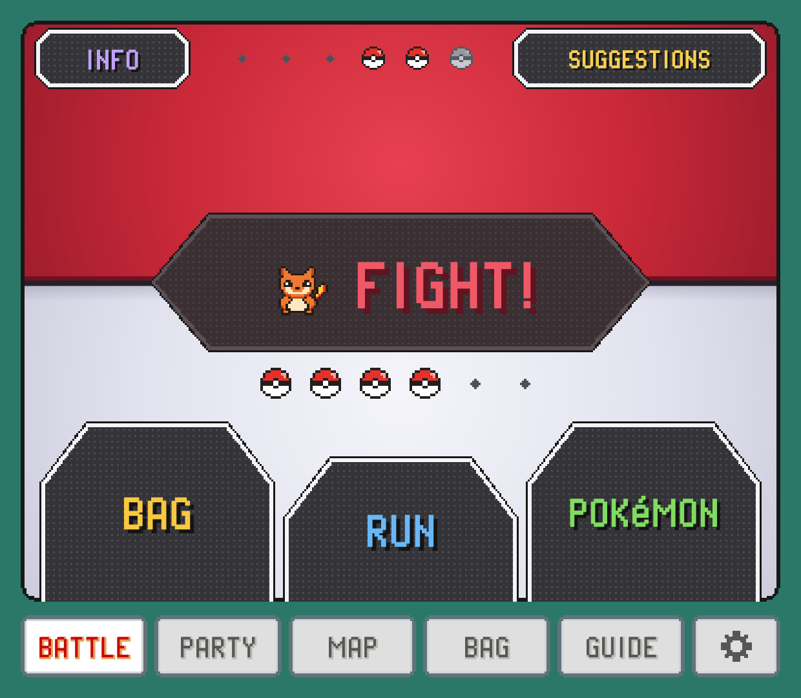
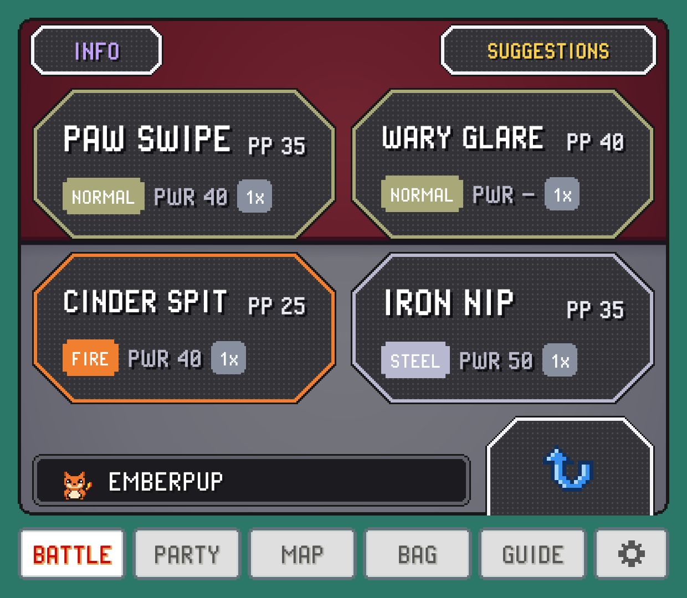

In a battle the companion becomes your battle screen: big touch buttons for your turn, and the answers to the questions you'd otherwise look up mid-fight. Will this move hit hard? What is the foe weak to? Who should I send in?

## The BATTLE tab

When a battle starts, a `BATTLE` tab appears at the front of the tab bar and opens by itself. When the battle ends, you're back on the tab you were using. To keep the companion where it is instead, turn off `JUMP TO BATTLE` in SETTINGS > `TWEAKS`; the `BATTLE` tab still shows up for you to tap.

The tab only appears when PokeDaisy can read the battle. In a game where it can't, you stay on your usual tabs rather than looking at an empty page.

## Touch buttons on your turn

On your turn the tab shows buttons laid out like the later handheld games: a big `FIGHT`, with `BAG`, `RUN` and `POKéMON` underneath. Above them, a row of balls shows your party's health (grey for a fainted Pokémon) and, in a trainer battle, the trainer's on the right. Between turns, while attacks play out, the tab shows `INFO` instead.

These buttons press the game's buttons for you: tap `FIGHT` and then a move, and the game picks that move. While the game catches up, a small rocking ball shows over the buttons and your own controls pause for a moment so the two don't fight each other.

What each button does:

- `FIGHT` opens your four moves right away. Tap one to use it, or `CANCEL` to go back.
- `BAG` opens the game's own bag on the top screen. Pick your item there; `BACK` on the companion backs out of it.
- `POKéMON` opens your party on the companion to switch (see [Switching during a battle](#switching-during-a-battle)).
- `RUN` runs away, and clears the "got away" message for you too. Against a shiny Pokémon it only picks `RUN` and leaves the rest to you: if the game asks whether you're sure (Unbound does), answer on the game's own `YES` or `NO`. If it asks at another time, `RUN` answers yes.

Elite Redux has no bag in its battle menu, so there the tab shows `RUN` and `POKéMON` side by side under `FIGHT`, with no `BAG`.

> [!NOTE]
> The touch buttons work in FireRed and Emerald and a growing list of hacks, in single battles. In other games, and in double battles, use your controls as usual: `INFO` and `SUGGESTIONS` still work. The [Supported games](supported-games.md) page lists what each game has.

## Moves and their verdicts

In the original FireRed, LeafGreen and Emerald in English, type tags are the game's own, read from your ROM.

Each move card shows its name, type, an icon for physical, special or status where the game's split is known, power (`PWR`) and `PP` left, plus a verdict against the foe in plain words (status moves deal no damage, so they have none):

| Verdict | Meaning |
| --- | --- |
| `SUPER 2x` | Super effective (`4x` when both of the foe's types are weak to it). |
| `NEUTRAL 1x` | Normal damage. |
| `RESISTED ½x` | Not very effective. |
| `IMMUNE 0x` | It won't affect the foe at all. |
| `STATUS` | A move that doesn't deal damage. |
| `NO PP` | Out of uses. You can't pick it. |

When you move the game's cursor with your buttons, the battle buttons show where it is with the DS games' own cursor: red corner marks that pulse in and out. In Game Boy games and games without one-press picks, they don't.

### BATTLE INFO

Want to work the battle out yourself? Turn off `BATTLE INFO` in SETTINGS (COMPANION group). The `BATTLE` tab then has only your battle buttons: no `INFO`, no `SUGGESTIONS` and no ratings on your moves. In a double battle, or in the window over the game, it just reminds you to use the game's own menu.

### BATTLE VIEW

The `BATTLE` tab opens on your battle buttons. If you'd rather read about the fight first and use the game's own menu, set `BATTLE VIEW` to `INFO` in SETTINGS (COMPANION group), or to `SUGGESTIONS` to see the best picks first. `BACK` on either still brings the buttons up.

### ONE-TAP MOVES

If you want to skip the `FIGHT` step, turn on `ONE-TAP MOVES` in SETTINGS (COMPANION group). Your four moves then sit right on your turn's screen, where `FIGHT` was, with `BAG`, `RUN` and `POKéMON` in a row underneath. One tap picks `FIGHT` and the move together.

### BATTLE STYLE

The battle screen comes in two looks, and both work the same way. `GEN 4` is the one shown above: big coloured buttons. `GEN 5` is laid out and coloured like the fifth generation's own touch screen, and fills the whole companion screen above the tab bar. It's a big ball, red on top and pale below, with a dark band across it that swells into the `FIGHT!` button in the middle. `BAG`, `RUN` and `POKéMON` are round dark plates rising from the bottom edge, `BAG` and `POKéMON` joined to the sides and `RUN` a little lower in between. Your party's balls sit under `FIGHT!`, and in a trainer battle the trainer's sit above it. `INFO` and `SUGGESTIONS` are the two small plates in the top corners.

In `GEN 5`, `FIGHT!` grows the band into a dark field with your four moves on it, each plate edged in its move's type colour: the name, the type and PP, then the move's power and, with `BATTLE HINTS` on, how well it hits. The round plate with the arrow at the bottom right takes you back. `POKéMON` opens the game's style of party screen: a plate for each of your Pokémon with its HP bar, and the one to send in marked `BEST` when `BATTLE HINTS` is on. While the attacks play out, the tab shows a closed ball in the dark until your next turn. With a controller, the cursor is a set of rounded pink corners that pulse, as in the game.

The first time you open PokeDaisy after this update, it asks which look you want, with both side by side. Change it any time with `BATTLE STYLE` in the companion's SETTINGS (COMPANION group). `ONE-TAP MOVES` works with either look. Yellow keeps its own black and white text boxes whichever you pick.

## INFO: the whole matchup on one page

Tap `INFO` for the battle at a glance. It's split down the middle, you on the left and the foe on the right:

- **Top**: a card for each Pokémon in battle with its icon, name, level, status, types and HP. Your card also warns you when the foe's type hits you hard (for example `ROCK 2x`), or says `RESISTS` when you shrug off its types.
- **Bottom left**: your moves, each with its verdict against the foe.
- **Bottom right**: what the foe is `WEAK TO`, what it `RESISTS` and what it's `IMMUNE TO`, strongest weakness first.

In a single battle all of that fits without scrolling. In a double battle the page scrolls.

### Foe details

Scroll down the foe's column for more:

- `ABILITY` and `HELD ITEM`.
- Its stats as they stand in this battle. Any stat that's been raised or lowered gets a small pill (+2 in green, -1 in red), and accuracy and evasion show up once they've changed.
- Its moves, each with a verdict on what it does to *your* Pokémon. A `SUPER` here is a warning.

To give the foe the whole page, tap the button with the corner arrows at the bottom right. Your side shrinks to a strip with your Pokémon's sprite and an upright HP bar, and the foe's facts and moves get the room. Tap it again to go back. PokeDaisy remembers your choice for the next battle.

### Shiny foes

When the wild Pokémon you're facing is shiny, the BATTLE tab says so with a gold `SHINY` plate at the top right, where a trainer's Poké Balls would be. On `INFO` its name gets a gold sparkle, and its icon shows in its shiny colours inside a gold frame. This works in the original FireRed, LeafGreen, Ruby, Sapphire and Emerald, in every language, and in the hacks [SHINY ODDS](controls.md#shiny-odds) lists, and goes well with it.

### Battle focus

Turn on `BATTLE FOCUS` in SETTINGS and `INFO` becomes one page that fits the screen, with nothing to scroll. It shows one Pokémon at a time:

- Its sprite, its name with its types under it, and beside them its `ABILITY` and, under that, its `HELD ITEM`. HP and level are left out.
- Its stats, with the same stage pills.
- Its four moves, two by two, each with its verdict.
- What it's `WEAK TO`, what it `RESISTS` and what it's `IMMUNE TO`.

The button at the bottom right turns the page from the foe to your Pokémon and back. The column down the right of the page follows it: on the foe's side it's the trainer's team (balls until you've seen them), on yours it's your whole team, every one showing. Tap one to look at it; the one you're looking at gets the frame. Back sits under the column, so the page gets the whole height. `SUGGESTIONS` and `STATS` aren't on this page; turn `BATTLE FOCUS` off to get them back.

In a trainer's double battle the page shows one foe at a time, the one on the left to start with. Both foes that are out show their icon in the column, and only the one you're looking at is framed. Tap the other to look at it, just as it is in the battle; a Pokémon that's out is never `UNSEEN`. Your side shows one of yours, the one on the left until you tap another.

### Foe IVs

The foe's IVs, EVs and nature are hidden by default, since knowing them is a bit of a peek. Turn on `FOE IVS` in SETTINGS and `INFO` gets a `STATS` button: your Pokémon and the foe side by side, each stat with its IV and EV, plus `NATURE` and `HIDDEN POWER`. It's the same view as the [STATS page in a summary](party.md).

## The foe's team

In a trainer battle, the bar along the bottom of `INFO` and `SUGGESTIONS` shows the trainer's whole team in order. Pokémon you've already seen show their icon (faded once fainted). The ones the trainer hasn't sent out yet are balls.

Tap any slot to look at that Pokémon instead of the one in battle: `INFO` and `SUGGESTIONS` switch to it, with a red frame around its slot and a pill by its name:

- `NEXT`: the one the trainer is about to send in. The pages switch to it by themselves when the trainer announces it.
- `FAINTED`: already beaten.
- `RESERVE`: seen earlier in this battle, now waiting.
- `UNSEEN`: not sent out yet. Tapping a ball shows you what's inside, so leave them alone if you like surprises.

Tap the framed slot again to go back to following the battle.

## SUGGESTIONS: who and what to use

Tap `SUGGESTIONS` for a ranking of your whole party against the foe. At the top is a `VS` line with the foe's level, types and HP. Below are the three best picks, marked `1ST`, `2ND` and `3RD`. Each shows the Pokémon's card (with `OUT` on the one already in battle) next to its best move and that move's verdict.

The ranking looks at how hard each Pokémon's best usable move hits this foe, and how badly the foe's types could hit back. Tap another of the trainer's Pokémon in the bottom bar and the list re-ranks against that one, which is handy for planning your next switch.

## Switching during a battle

`POKéMON` opens your party with the game's own party slots, filling the tab, and "Choose a POKéMON." with a `CANCEL` button below. The cursor starts on SUGGESTIONS' top pick, tagged `BEST`; the Pokémon already in battle is tagged `OUT`.

Tap a Pokémon to send it in. PokeDaisy works the game's party menu for you, and the top screen holds still while it does, so you don't watch the menus flash by. A fainted Pokémon, an egg or the one already out can't be picked.

The same pane appears when the game asks you to choose, for example after one of your Pokémon faints.

This works in the Game Boy games too (Red, Blue, Yellow, Yellow Legacy, PureRed, PureBlue, Gold, Silver, Crystal, Crystal Legacy, Crystal Clear, Prism and Polished Crystal). There the game asks what to do with the Pokémon you picked, and PokeDaisy answers its switch option for you.

## On one screen: BATTLE BUTTONS

On a device with one screen, held sideways, three buttons sit at the top right of the screen during a battle: `FIGHT`, `POKéMON` and `RUN`. They use the room beside the game (with `ASPECT` on `EXPAND`, the background past the battle's edges; on `ORIGINAL`, the black bar), and on a screen where that's narrow they reach a little into the battle's top-right corner, where there's only background.

- `FIGHT` (with your Pokémon's icon on it) opens your moves as a list down the right side of the screen, one row each in the colours of the BATTLE tab's cards: the move's name and `PP` left, its type and power, and with `BATTLE HINTS` on its verdict against the foe (like `SUPER 2x`). Tap one to use it; a move out of PP can't be picked.
- `POKéMON` opens your party as a list down the right side, drawn like the game's own party list: each Pokémon's icon over its ball (animated like the game's), name, level or status, and HP bar. `BEST` marks the one SUGGESTIONS would pick (it's highlighted, like the game's cursor) and `OUT` the one battling. Tap one to send it in.
- `RUN` runs away. It's greyed out in a trainer battle, where you can't.

To close a list without picking, tap outside it or `CANCEL` under it. The buttons look like the BATTLE tab's and dim while the battle plays out. They slide in from the right edge as a battle starts, and slide away while a list is open or the game's own party or bag screen is up. They show in single battles of the games with touch buttons, and only when there's room beside the game: not with `ASPECT` on `STRETCH`, nor while the companion is locked open beside the game. To hide them, turn off `BATTLE BUTTONS` in SETTINGS (SCREEN group, on either screen).

In HeartGold, SoulSilver, Platinum, Black, White, Black 2 and White 2 the battle stays wide, and its text box becomes a strip across the bottom of the screen: the game's question ("What will ... do?") at the far left, and the game's four buttons at the right, `FIGHT` and `BAG` over `POKéMON` and `RUN`. Each game keeps its own look: HeartGold's and SoulSilver's coloured buttons, Platinum's, Black's and White's dark buttons with coloured words, and Black 2's and White 2's black buttons outlined in colour, those last two's round battle panels laid out as the same four buttons. They work like the GBA games' menu: corners pulsing like the game's cursor mark your choice (red in HeartGold, SoulSilver and Platinum, pink in Black and White, white and red in Black 2 and White 2); move them with the D-pad and press A, or tap a button. `FIGHT` turns the strip into your four moves, drawn like the game's own move buttons: the name, the type and the PP, and in the corner how hard the move hits the foe (`2x`, `1x`, `½x` and so on). B, or the back button beside them, goes back. `BAG` and `POKéMON` open the game's own bag and party, floating over the battle once they've faded in, and when you're done there the buttons come back. This is while `DS LAYOUT` is on `ONE SCREEN`. With `BATTLE BUTTONS` off, or in a double battle, the game's own battle buttons float in instead. On `PICTURE IN PICTURE` the game's own buttons are already there in the corner, so you tap those.

## Turning the hints off

If you'd rather work out matchups yourself, turn off `BATTLE HINTS` in SETTINGS. The verdicts on moves, the foe's weaknesses, the warnings on your card and the `BEST` tag all go away. The facts stay: HP, types, levels, moves, power and PP. (`SUGGESTIONS` is still there if you ask for it.)
