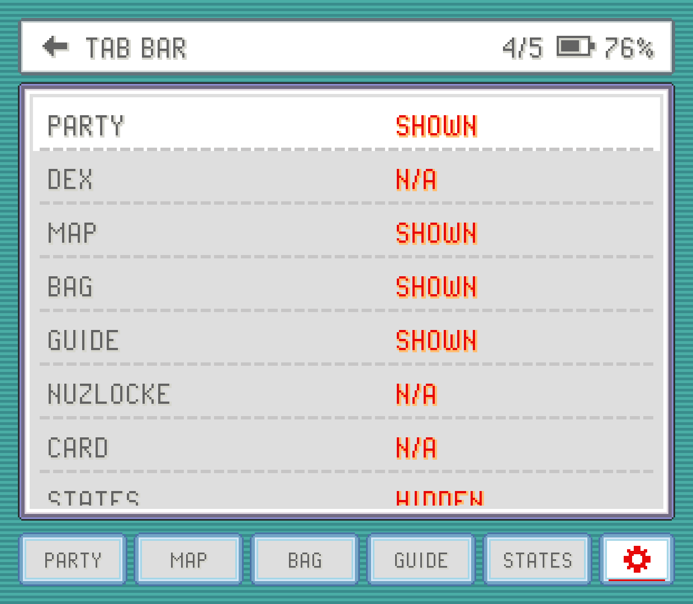
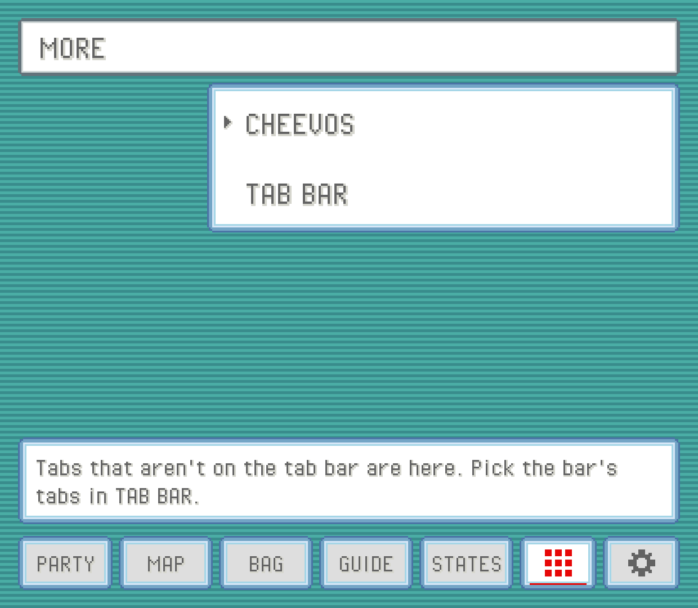
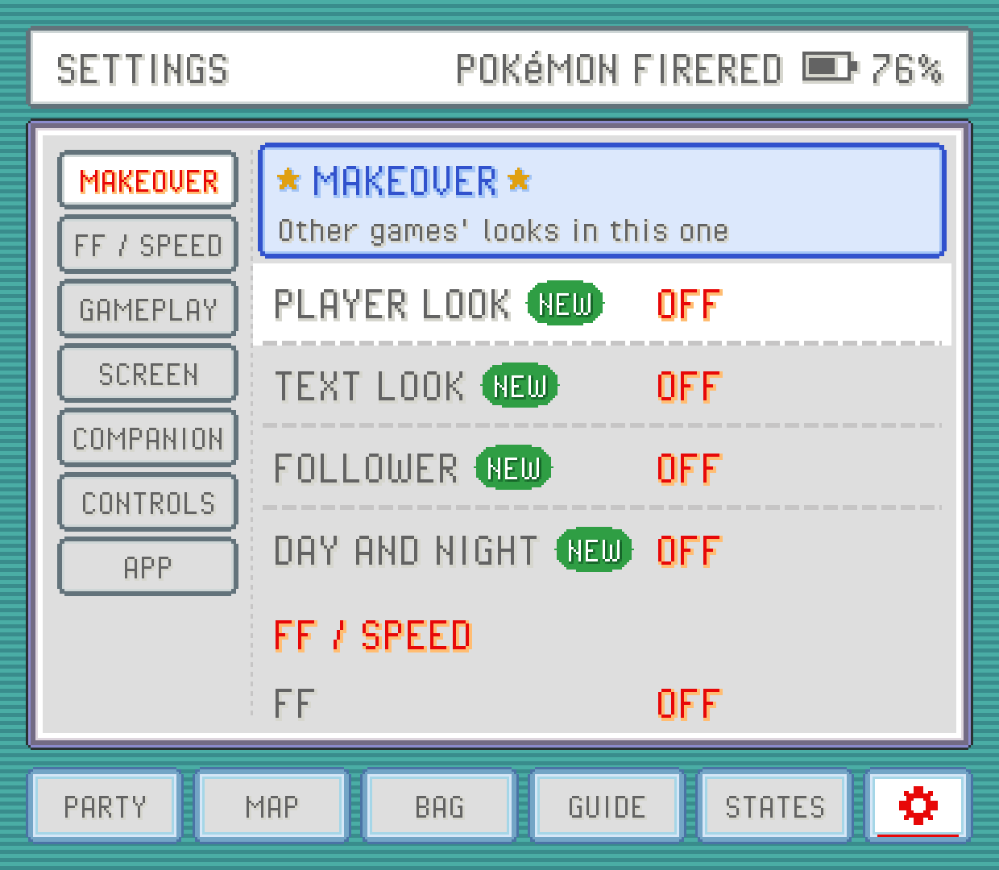
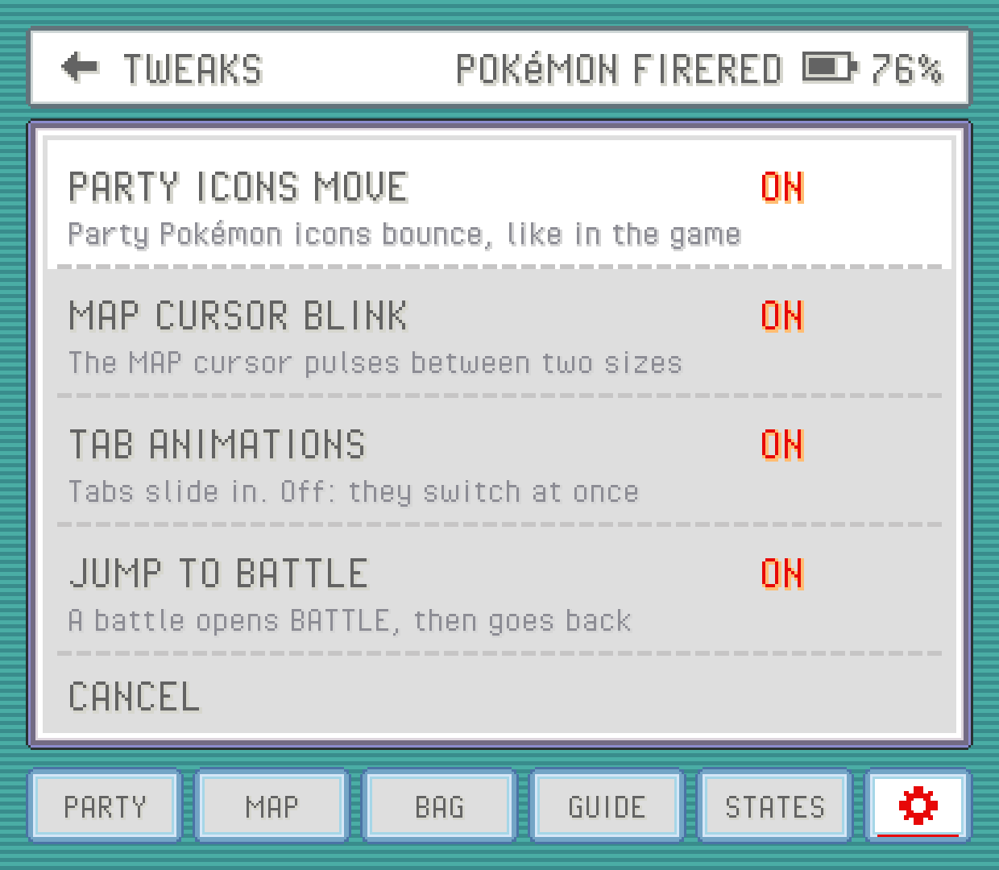

The companion is everything on the bottom screen while a game runs. It reads your game as you play, so your party, bag, location and battles are always up to date without opening a single menu on the top screen. It's drawn in the game's own menu style: FireRed's party screen in FireRed, Emerald's in Emerald, and each supported hack's own look where it has one.

You don't have to do anything to start it. Open a supported game and the companion fills in once the game has loaded. On a device with only one screen it lives in a panel beside the game instead (see [Devices](devices.md)).

## The tabs

Along the bottom of the companion is a row of tabs, with `MORE` (a grid of nine squares) and the SETTINGS gear at its right end. Out of the box you get:

| Tab | What it shows |
| --- | --- |
| `PARTY` | Your team, and a full summary for each Pokémon. See [Party and summaries](party.md). |
| `DEX` | Your Pokédex with seen and caught marks. See [Pokédex](dex.md). |
| `MAP` | The region map with you on it. See [Map](map.md). |
| `BAG` | Every pocket of your bag. See [Bag](bag.md). |
| `GUIDE` | Hints, the next boss and what's around you. See [Guide](guide.md). |

A few more are off the bar to begin with and wait under `MORE`: `BOXES` (your [PC boxes](boxes.md), FireRed for now), `CARD` (your [trainer card](trainer-card.md)), `STATES` (save states) and `CHEEVOS` ([RetroAchievements](achievements.md)). `NUZLOCKE` joins them once you turn on [Nuzlocke](nuzlocke.md) tracking for a game.

Some tabs only appear when the game has what they need. `DEX` needs the game's Pokédex data and `GUIDE` needs a guide for that game, so a game without them has fewer tabs. The bag tab also takes the game's own word for it: `PACK` in Gold, Silver, Crystal, Crystal Clear and Prism, `CUBE` in Unbound, `INVENTORY` in R.O.W.E., `POCKETS` in Super Mariomon, `BAG` everywhere else.

### Before you're in the game

While the game is still on its title screen, its intro or the CONTINUE menu, `PARTY`, `BAG`, `MAP` and `CARD` wait: they show the game's own empty party slots with `PRESS START` blinking, rather than whatever party the game has loaded so far. They fill in as soon as you're walking around or in a battle. A game resumed from where you left it is in the game already, so they show right away. `STATES`, `SETTINGS` and the rest work the whole time, so you can still load a save state from the title screen.

### Choosing your tabs

Up to five tabs fit next to the gear. To pick them, open SETTINGS and tap `TAB BAR` in the COMPANION group, or tap the `TAB BAR` button at the bottom of `MORE`. Each tab there says `SHOWN` or `HIDDEN`; tap one to flip it. The title counts how many you've placed (for example `5/5`). If the bar is full, hide one first. Tabs always sit in the same order on the bar, whichever you pick. When the game you're playing doesn't have one of your tabs (a game with no DEX, say), its place goes to one of the game's other tabs, so the bar stays full whenever the game has enough.

Your choice is shared by every game. A tab the running game doesn't have shows `N/A` and keeps its setting for the games that do.

### Tabs that aren't on the bar

Hidden tabs are still one tap away. Tap `MORE`, left of the gear: every tab you left off the bar is there as an app, with a coloured icon and its name. Tap one to open it. While it's open `MORE` stays lit, and BACK takes you back to it.

Under the icons, a line reminds you that you pick the bar's tabs yourself, and the `TAB BAR` button takes you straight to that page in SETTINGS. When every tab the game has is on the bar, `MORE` isn't shown.

### The BATTLE tab

When a battle starts, a `BATTLE` tab appears at the front of the bar and opens by itself. To make room, the last of your chosen tabs steps aside until the battle ends. When the battle is over, the tab you had open before comes back. Everything about battles is on the [Battles](battle.md) page.

If you'd rather stay where you are when a battle starts, turn off `JUMP TO BATTLE` in TWEAKS (below): the `BATTLE` tab still appears, but doesn't open on its own.

## The BACK button

The device's BACK button works for the companion, from either screen:

- **Tap BACK** to go back one step in the companion: close a summary, a pick-list, a pop-up window or a sub-page of SETTINGS, or return from a tab you opened from `MORE`.
- **Hold BACK** to leave the game.

On a controller, the HOME or guide button does the same as a BACK tap unless you've bound it to something else.

## Button sounds

Companion buttons play your game's own menu click, recorded from the ROM itself, so they sound like the game. Buttons that press the game's buttons for you (the battle buttons, for example) stay quiet, because the game makes its own sound. There's no vibration. To turn the clicks off, switch `CLICK SOUND` to `OFF` in SETTINGS.

## The SETTINGS tab

The gear opens the companion's SETTINGS, laid out like FireRed's OPTION screen. The title shows the game's name and your battery. Tap a row to change it: on / off rows flip, rows with more choices open a short list to pick from, and rows with an arrow at their right end open a page of their own. SETTINGS remembers where you were, so a trip to another tab and back lands on the same row.

The options come in groups, the ones you change while playing first:

- **MAKEOVER**: `PLAYER LOOK`, `RIVAL LOOK`, `TEXT LOOK`, `FOLLOWER` and `DAY AND NIGHT`, fresh looks for your game. It sits at the top in a blue frame of its own, and only shows in a game it works in. See [MAKEOVER](#makeover) below.
- **FF / SPEED**: `FF`, `FF SPEED`, `GAME SPEED`, `REWIND` and `SPEED OPTIONS` (a page with `SCENE SPEEDS`, `FF MODE` and `FF MUSIC`). See [Fast-forward](fast-forward.md).
- **GAMEPLAY**: `WILD ENCOUNTERS`, `REUSABLE TMS`, `SHINY ODDS`, `NUZLOCKE`, `AUTO-RUN`, `RUN INDOORS` and `CHEATS`. See [Controls](controls.md), [Bag](bag.md), [Nuzlocke](nuzlocke.md) and [Cheats](cheats.md).
- **SCREEN**: `ASPECT`, `HUD`, `DISPLAY OPTIONS` (a page with `STATUS BAR`, `SHADERS`, `OVERLAY` and `LIGHT COMPANION`), `DARK MODE`, `FPS / CPU` and, depending on your device, `BATTLE BUTTONS`, `COMPANION VIEW`, `COMPANION BUTTON`, `SWAP SCREENS` or `SINGLE SCREEN`. See [Screen and display](screen.md).
- **COMPANION**: `BATTLE HINTS`, `ONE-TAP MOVES`, `FOE IVS`, `TAB BAR`, `CLICK SOUND` and `TWEAKS`.
- **CONTROLS**: `GAME BUTTONS`, `HOTKEYS`, `QUICK MENU` and `TOUCH CONTROLS`. See [Controls](controls.md).
- **APP**: `TIPS`, `LANGUAGE` and `HELP` (this manual).

Every option is explained in the [Settings reference](settings-reference.md). The top screen has its own Settings too, with more options and a search box.

### TWEAKS

`TWEAKS` holds small on / off preferences, all on to start with:

| Tweak | What it does |
| --- | --- |
| `PARTY ICONS MOVE` | Party icons bounce, like in the game. |
| `MAP CURSOR BLINK` | The MAP cursor pulses between two sizes. |
| `TAB ANIMATIONS` | Tabs slide in. Off, they switch at once. |
| `JUMP TO BATTLE` | A battle opens the `BATTLE` tab, then goes back to where you were. |

### MAKEOVER

`MAKEOVER` is the group at the top of SETTINGS, framed in blue: it brings fresh looks into the game you're playing, with `PLAYER LOOK`, `RIVAL LOOK`, `TEXT LOOK`, `FOLLOWER` and `DAY AND NIGHT` below. It only shows in a game where one of them works.

### PLAYER LOOK

Ever wanted to walk around Emerald as the hero of FireRed, or the other way round? `PLAYER LOOK` dresses you up as another game's hero. Your sprite on the map changes (walking, running, on a bike, surfing, fishing), and so do your back in battle, your picture on the trainer card and your head on the region map. The companion's `MAP` and `CARD` follow along.

Tap the row and every hero you can wear shows as a tile, each one walking in place as they look on the map, with the game they come from under their name. The first tile, `OFF`, is your own hero. Tap a tile to put it on.

PokeDaisy doesn't come with any of these pictures: they're taken from your own copy of the other game. So the tiles only show heroes from FireRed, LeafGreen, Ruby, Sapphire or Emerald carts, or from Heart and Soul, that you've played here once or that are in your library. Each of those games gives you its two heroes (Ruby and Sapphire's look a little different from Emerald's, and Heart and Soul brings Gold and Kris), and you can also pick the other hero of the game you're playing. Heart and Soul's heroes can be worn in the other games, but Heart and Soul itself keeps its own. Until one is found the row shows `N/A`. It starts on `OFF` (your own hero), and each game remembers its own pick.

Your save stays exactly as it was. The change only lives in the game's memory while you play, and the save just notes which of the game's two heroes you are. Turn it `OFF` and your own hero is back at once, and the save opens the same in any other emulator.

> [!NOTE]
> `PLAYER LOOK` works on the original FireRed, LeafGreen, Ruby, Sapphire and Emerald carts, in every language, and on Emerald Kaizo, Emerald Legacy, Emerald Imperium and Ultra Violet. Poses only one game has, like Emerald's wheelies and diving, use the nearest pose the other hero has.

You can also walk around as one of your own Pokémon. With a game whose Pokémon follow you (Heart and Soul, R.O.W.E., Recharged Yellow or Emerald Seaglass) played here or in your library, the tiles also show the Pokémon in your party, walking as they follow you in that game. With more than one of those games, each Pokémon comes from one of them only, and its tile says which. Pick one and it takes your place on the map (walking, running, on a bike and surfing), on the trainer card and with its back to you in battle. Only the first 386 can be picked, and a few of the very biggest aren't among them.

### RIVAL LOOK

In Ruby, Sapphire and Emerald your rival is the game's other hero. With `RIVAL LOOK` on (it starts on), they dress up too, as the other hero of the game you picked: wear FireRed's boy and your rival turns up as its girl, on the map and in battle. Turn it `OFF` and your rival keeps their own look while you wear another. It shows `N/A` until you pick a `PLAYER LOOK`, and FireRed and LeafGreen don't have it (their rival isn't one of the heroes).

### TEXT LOOK

`TEXT LOOK` gives your game the other game's text boxes and letters: FireRed's rounded blue and white box in Emerald, or Emerald's teal one in FireRed and LeafGreen. Everything people say, signs and the save question show in it, and the letters of every menu change too.

Like the heroes, the box and the letters come from your own copy of the other game, so the row shows once you've played it here or it's in your library. Tap it to switch between your game's own look (`OFF`) and the other game's. Your save isn't touched.

> [!NOTE]
> The letters only change between games in the same language (an English FireRed's in an English Emerald, say), since each language has letters of its own. The boxes work in every language. Emerald Imperium keeps its own box but takes the letters.

### FOLLOWER

With `FOLLOWER` on, the first Pokémon in your party walks a step behind you on the map, turning corners with you, keeping up when you run or ride your bike, and waiting while you surf. It's drawn by PokeDaisy over the game, so your game and your save don't change. It doesn't block anyone and you can't talk to it, and after you go through a door it shows up again with your first step.

Its sprite comes from a game whose Pokémon follow you (Heart and Soul, R.O.W.E., Recharged Yellow or Emerald Seaglass), like the Pokémon you can wear with `PLAYER LOOK`, so the row shows `N/A` until one of those has been played here or is in your library. It's off to start with, and games whose Pokémon already follow you don't have it.

### DAY AND NIGHT

With `DAY AND NIGHT` on, the map follows your device's clock: a soft pink at dawn, the game's own colours by day, an orange glow at dusk and a deep blue at night. Only the outdoors changes, and only while you walk around: text boxes and menus keep their colours, buildings stay lit, and battles look as they always do. It eases in and out as you go between them.

It works in every GBA game except those that already change with the time of day themselves (Unbound, Heart and Soul, Elite Redux). It's off to start with. Your game and your save don't change: only the picture does.

### TIPS

PokeDaisy does a lot, and some of it is easy to miss. Once you've played for about half an hour, a small card with the PokeDaisy flower now and then shows you a feature you haven't tried yet, like the zoom and look around with `EXPAND`, the `QUICK MENU`, `AUTO-RUN` or the PC from anywhere. With two screens it shows on the companion, so the game stays clear; on one screen it sits at the top of the game.

Most cards come up when the feature would help right then: `AUTO-RUN` after you've held B to run for a while, `WILD ENCOUNTERS` after a few wild battles in a row, `REUSABLE TMS` right after a TM gets used up.

- **TRY IT** (its button says what it does, like `TURN ON` or `SHOW ME`) does the thing at once.
- **`NO THANKS`** means that card never comes back.
- Leave it, and it goes by itself when its bar runs out. It may come back once, much later.

A card only shows while you're walking around the field, never in a battle, a menu or a conversation. There are always at least 5 minutes of play between two cards, and a feature you already use never gets one. Turn them off with `TIPS` in the `APP` group, on either screen.

### LANGUAGE

The app's own text comes in English, Japanese, French, German, Italian, Spanish and Portuguese, with Brazil's and Portugal's Portuguese as two choices. `LANGUAGE` starts on `AUTO`, which follows the game's language; pick another and both screens switch at once.

No game came out in Portuguese, so on a phone or handheld set to Portuguese, `AUTO` shows Portuguese over an English game too. The GUIDE's written pages stay in English in Portuguese.

This only changes PokeDaisy's words (buttons, labels, hints). Pokémon, move and item names stay as your game has them, so a French game shows its French names whatever you pick, and an English game keeps its English ones.

## Closing and restarting

At the very end of SETTINGS, under a line, are two buttons:

- `CLOSE GAME` returns to your library. With `RESUME GAMES` on (top-screen Settings, the default), the game picks up where you left it next time. With it off, anything since your last in-game save is lost, and the confirmation says so.
- `RESTART GAME` reboots the game and reads its save file again from storage. Anything you haven't saved in the game is lost. It's the fix when a save you copied in doesn't show up.

Both ask before they do anything.

On a device with two screens there's also `CLOSE COMPANION`. It hands the companion's screen back to Android while the game keeps running, so you can use another app there (the top screen with `SWAP SCREENS` on). Press BACK on the game to bring the companion back. With `SWAP SCREENS` on, BACK opens it over the game instead, and `OPEN COMPANION` at the bottom of its `SETTINGS` puts it back on the top screen.

> [!TIP]
> Not sure what a row does? `HELP`, the last row of SETTINGS, opens this manual right on the bottom screen.
