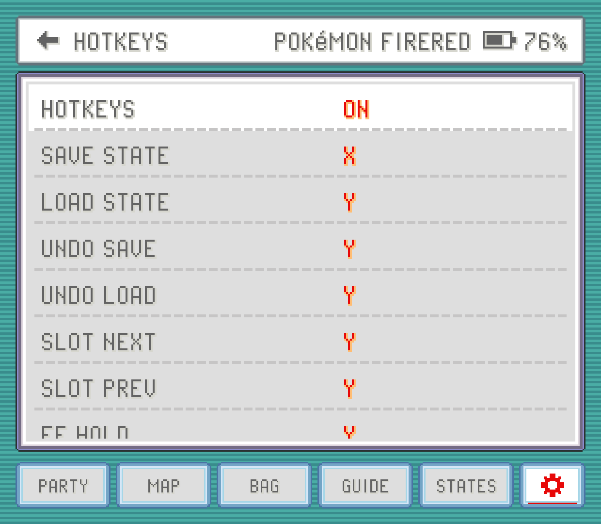
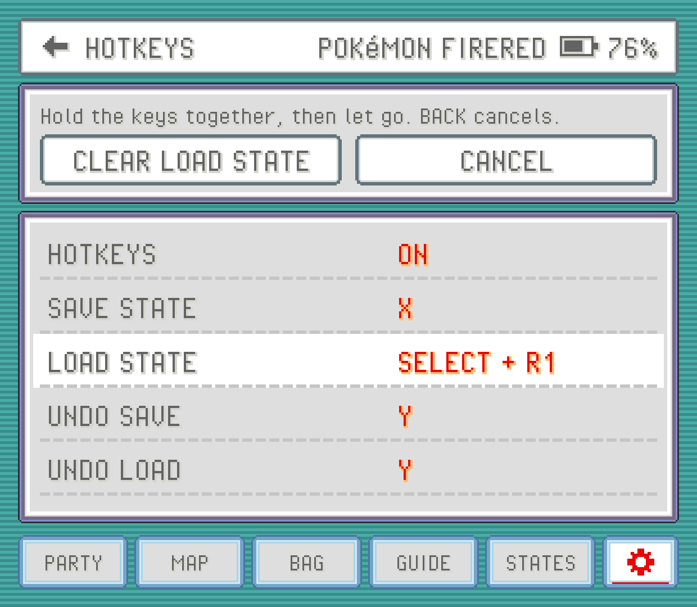

PokeDaisy works out of the box on handhelds like the AYN Thor: the face buttons, shoulders, START and SELECT are the GBA's, and a few button combinations do emulator things like saving a state. Everything here is about changing that: which button presses what, which shortcuts exist, and what happens when you plug in a controller or play by touch.

The button settings live in the `CONTROLS` group, on both screens: the top screen's Settings (from the library) and the companion's `SETTINGS`. `AUTO-RUN`, `RUN INDOORS`, `WILD ENCOUNTERS` and `SHINY ODDS` change the game itself, so they're in the companion's `GAMEPLAY` group, near the top.

## Game buttons

`GAME BUTTONS` sets which physical button presses each GBA button. Open it and you'll see a row per button with the keys it's on now, in three groups: the buttons every game uses, then the DS games' own and the GBA and Game Boy games' own.

| Group | Button | Default |
| --- | --- | --- |
| `ALL GAMES` | `GBA A` and `GBA B` | A and B |
| | `GBA L` and `GBA R` | L1 and R1 |
| | `GBA START` and `GBA SELECT` | START and SELECT |
| | `GBA TURBO A` and `GBA TURBO B` | Nothing |
| | `D-PAD UP`, `D-PAD DOWN`, `D-PAD LEFT` and `D-PAD RIGHT` | Nothing |
| `DS GAMES` | `X` and `Y` | X and Y |
| `GBA AND GAME BOY` | `START 2` and `SELECT 2` | X and Y |
| | `TO COMPANION` | X |

`X` and `Y` are the DS games' own X and Y. The GBA and Game Boy games have no X or Y, so the same buttons get rows of their own there: `START 2` and `SELECT 2` are a second START and SELECT, so X opens the menu and Y uses your registered item, like in the DS games. On a handheld with two screens, `TO COMPANION` does one more thing on the field: see [X takes your buttons to the companion](#x-takes-your-buttons-to-the-companion). Each GBA button also has a keyboard key (Z, X, A, S, Enter and so on) for when you play with one.

Since a DS game and a GBA game never run at the same time, a button can be in both groups at once: X is the DS games' `X` and the other games' `START 2`. Change one and the other stays as it was. So you can keep X for the companion in the GBA games and put `START 2` on another button, or clear `TO COMPANION` to have X be only a second START.

In a game, the companion's `GAME BUTTONS` shows the group for the game you're playing under `ALL GAMES`. The top screen's Settings shows all three.

To change one, tap its row (it says `PRESS A BUTTON…`) and press the button you want on your device. That works the same on the top screen and on the companion: there, while a row waits, the game's screen shows a window asking for the button and the keys you hold. `CANCEL`, or `BACK`, leaves the button as it was. `TURBO A`, `TURBO B`, the D-pad rows and the GBA and Game Boy rows also get `CLEAR`, which takes them off every button again.

The new button replaces everything that row had, keyboard key included. A button can only do one thing in a game: put it on a new row and it leaves the old one in the same games. `TO COMPANION` is the exception: it shares its button with whatever else is on it.

> [!NOTE]
> Buttons go by Android's names, which follow an Xbox controller's layout. On AYN and Retroid devices, `A` is the bottom face button even where the printed label says something else. If A and B feel swapped, swap them here.

The D-pad and the analog stick always move; they can't be remapped. The four D-pad rows add another button to a direction, for a controller whose D-pad sends something else. The 8BitDo Micro does in its keyboard mode, where its D-pad types letters: put each direction on its row and they move again. A direction's button also comes off any hotkey that was that button alone (the Micro's up is the C key, `ZOOM`'s). First-time setup has a page listing these buttons too, and you change them right there the same way.

## X takes your buttons to the companion

On a handheld with two screens, or a phone held upright with a controller, press `X` (the `TO COMPANION` button in `GAME BUTTONS`) while you walk around in a GBA or Game Boy game and your buttons move down to the companion, like the menu on a DS game's touch screen. A silver strip slides up along the bottom of the game with an arrow pointing down at the companion, and `L` and `R` slide in at the ends of the companion's tab bar.

While your buttons are down there, the game keeps running but doesn't see them:

- The D-pad moves the cursor and `A` picks what it's on.
- `L` and `R` move between the tabs.
- `B` goes back, and when there's nothing left to go back from, it gives your buttons back to the game.
- `X` or `START` give them back from anywhere. So does a tap on the silver strip.

They also come back by themselves when the game needs them: a battle starts, or something you picked on the companion opens on the game, like the PC or a flight.

`X` only does this on the field with nothing else going on. In a text box, a menu or a battle it's still `START`, as long as it's also `START 2`. DS games keep their own X.

## Turbo A and B

`TURBO A` and `TURBO B` press A or B over and over for as long as you hold them. They're good for mashing through text, or for anything that wants you to hammer a button. They aren't on any button until you put them on one in `GAME BUTTONS`.

Turbo counts in game time, so with fast-forward on it mashes faster along with the game. It pauses while the companion's battle buttons are pressing the game's buttons for you.

## Hotkeys

Hotkeys are shortcuts for things outside the game: save states, fast-forward, leaving the game. A hotkey can be one button or a **chord**, several buttons pressed together. SELECT + R1 is a chord: the second button fires it while the first is held.

Chords don't take a button away from the game. SELECT alone still works in game; only SELECT + R1 together saves a state.

When SELECT or START is part of a chord, the game gets it when you let go rather than when you press it. That way holding SELECT to start SELECT + START doesn't press SELECT in the game just before you leave it. If you press another game button while holding SELECT or START (or were already holding one), it goes to the game right away, so the game's own button combinations keep working.

| Hotkey | What it does | Controller | Keyboard |
| --- | --- | --- | --- |
| `SAVE STATE` | Saves a state in the current slot | SELECT + R1 | F1 |
| `LOAD STATE` | Loads the current slot's state | SELECT + L1 | F2 |
| `UNDO SAVE` | Puts back the state your last save replaced | | F3 |
| `UNDO LOAD` | Returns to where you were before your last load | | F4 |
| `SLOT NEXT` | Next save state slot | | ] |
| `SLOT PREV` | Previous save state slot | | [ |
| `FF HOLD` | Fast-forward while held | R2 | Space |
| `FF TOGGLE` | Fast-forward on or off | | Tab |
| `SPEED CYCLE` | Steps the game speed through 1x, 1.5x, 2x, 3x and 4x | L2 | = |
| `SLOWMO HOLD` | Half speed while held | | minus |
| `REWIND HOLD` | Plays the last moments backwards (needs `REWIND` on) | | R |
| `ZOOM` | Steps the zoom (needs `ASPECT` set to `EXPAND`) | R3 (shown as `THUMBR`) | C |
| `SOFT RESET` | The game's own soft reset: holds A + B + SELECT + START, back to the title screen. Anything since your last in game save is lost, as on the console | | H |
| `EXIT GAME` | Leaves the game, back to the library | SELECT + START | Esc |
| `RESTART GAME` | Starts the game again from its save, like `RESTART GAME` in the companion's `SETTINGS` | | |
| `CLOSE APP` | Leaves the game (it saves as usual) and closes PokeDaisy completely, so it's gone from your recent apps | | |
| `QUICK MENU` | Opens the [quick menu](#the-quick-menu), or closes it | L3 (shown as `THUMBL`) | |
| `COMPANION` | Opens the companion over the game on one screen, where you can hide its edge button with `COMPANION BUTTON`. Also brings it back after `CLOSE COMPANION`. On a phone held upright it hides the companion or brings it back. In a DS game with two screens it swaps the second screen between the touch screen and the companion, and your buttons go with it | | |
| `FREE FLIGHT` | Takes off to [fly over the map](map.md#flying-over-the-map), or lands | | |
| `MUTE` | Mutes the game, or brings its sound back (`MUTE GAME` in [SOUND](fast-forward.md#game-volume-and-mute-sound)) | | |
| `TOUCH SCREEN` | In a DS game on one screen: brings its touch screen up over the game, or closes it (see [DS layout](devices.md#ds-layout-two-screens-on-one)) | L2 | T |
| `DS LAYOUT` | In a DS game on one screen held sideways: steps to the next `DS LAYOUT` (`ONE SCREEN`, `SIDE BY SIDE`, `LARGE + SMALL`, `PICTURE IN PICTURE`, `STACKED`, then round again), its name showing on the game for a moment | R2 | |

`RESTART GAME`, `CLOSE APP`, `COMPANION`, `FREE FLIGHT` and `MUTE` have no buttons until you give them some. `TOUCH SCREEN` and `DS LAYOUT` share L2 and R2 with `SPEED CYCLE` and `FF HOLD`: in a DS game on one screen the triggers are theirs, and everywhere else they're speed's, so changing one never asks you to move the other.

The speed hotkeys are explained in [Fast-forward and game speed](fast-forward.md), states and rewind in [Saves](saves.md), and zoom in [Screen](screen.md).

### Changing a hotkey

Tap a hotkey, under Settings > `HOTKEYS` on the top screen or `SETTINGS` > `HOTKEYS` on the companion; it says `PRESS KEYS…`. Press one button, or hold several together and release, to set it. While a hotkey waits for keys:

- `CLEAR` leaves it with no button at all (it shows `-`).
- `CANCEL`, or `BACK`, keeps it as it was.

On the companion, the game's screen shows a window while a hotkey waits, with the buttons you're holding, since that's where your presses go. The game doesn't see them meanwhile, and neither do the other hotkeys.

The new buttons replace the hotkey's whole binding, keyboard key included.

### When a button is already taken

If you pick exactly the buttons another hotkey already has (the same buttons in any order), you get `KEY IN USE`. Tap `MOVE` to take them from the other hotkey, or cancel to leave both as they were. Sharing only some buttons is fine: SELECT + R1 and SELECT + L1 can both exist, that's how chords work.

### Turning hotkeys off

The `HOTKEYS` switch at the top of the page turns every hotkey off at once. The bindings stay as they are (greyed out) and every button goes straight to the game. It's handy if a game needs a combination that clashes with a hotkey, and you'd rather not rebind anything.

## The quick menu

The quick menu puts the things you'd otherwise dig through menus for under one button. Press L3 (the left stick, pushed in) and your actions pop up over the game, as a ring or in rows (see `STYLE` below). The rest of the HUD fades back while it's open, and any HUD panel you had open (a summary, the map, the bag, the wild list) closes:

| Action | What it does |
| --- | --- |
| `PC` | Opens your game's own PC right where you stand, as in the [bag](bag.md). |
| `FLY` | Lists the places you can fly to; pick one and off you go. Needs a Pokémon in your party that knows the move. |
| `TAKE OFF` | Takes off on your Pokémon's bird and lets you [fly over the map](map.md#flying-over-the-map); while you're up it says `LAND` and brings you down. The original games in every language, Emerald Legacy and the hacks listed in [Map](map.md#flying-over-the-map). |
| `FLASH` | Lights up a dark cave, the way the move does from the game's party menu: the Pokémon that knows it shows up and the cave lights up. It only shows while a Pokémon in your party knows `FLASH`, and it's greyed out where it isn't dark. In Emerald it also opens the sealed wall in the ancient tomb when you stand where the game asks. It needs the same badge as in the game. |
| The keep-away spray | Uses an item from your bag that keeps wild Pokémon away (the tile shows its icon and name). With more than one kind in your bag, it lists them with how many you have and how many steps each lasts, so you pick. While one is still working it's greyed out and says how many steps are left. |
| `BIKE` | Gets on your bike. While you're riding it says `GET OFF` and gets you off. |
| `ROD` | Casts your best fishing rod. Face the water first. |
| `WILD` | Turns `WILD ENCOUNTERS` off, and back on the next time. An `OFF` tag on its corner says they're off. It shows in games where `WILD ENCOUNTERS` works. |
| `SAVE STATE`, `LOAD STATE` | Saves or loads the current state slot. |
| `FF` | Turns fast-forward on or off. |
| `COMPANION` | Opens the companion (on a device with one screen). |

Press L3 and the menu stays open: move with the D-pad or the left stick (on the ring, point the stick at an action), press `A` to use it, and `B` (or L3 again) closes it. You can also tap an action on the screen. While the menu is open your buttons work it, not the game, and the game keeps running underneath.

An action you can't use right now is greyed out and says why, like a battle going on or nothing for it in your bag. `BIKE` and `ROD` use the game's own way of using a registered item, so the game decides the rest: where you can't ride or fish, it tells you so. They work in FireRed, LeafGreen, Ruby, Sapphire and Emerald, in Emerald Kaizo and Ultra Violet, which run on those games, and in SoulGold, through its own `SELECT` wheel (it borrows the wheel's bottom slot for a moment, then puts back what you had there). `PC`, `FLY` and the spray show only in games where the [bag](bag.md) and [map](map.md) offer them. `FLASH` works in FireRed, LeafGreen, Ruby, Sapphire and Emerald, in every language PokeDaisy supports, and in Unbound, Radical Red, Amethyst, Sword and Shield Ultimate Plus, GS Chronicles, Ultra Violet, Gaia, Odyssey, Orange Islands, Let's Go, Glazed, Emerald Kaizo, Emerald Legacy, Recharged Emerald, Lazarus, Emerald Imperium, Heart and Soul, SoulGold and the randomized games. It asks for the badge the game's own menu asks for (Unbound, Gaia and Orange Islands ask for none).

Pick which actions show, and turn the rest off, in `QUICK MENU` (in the `CONTROLS` group of Settings on either screen). Its `STYLE` picks how they're laid out (tap it to switch):

- `RING` (to start with): the actions round a circle, like the weapon wheel in a modern game, each the same distance from the next. Point the left stick at one, and its name shows in the middle, with a light tick of vibration each time you move onto another one. The D-pad steps round it too.
- `GRID`: rows of tiles, all the same size. The D-pad steps through them.

`LABELS` (on to start with) puts each action's name under its icon. Turn it off for icons alone, smaller and closer together: the highlighted one is then named under the row, or in the middle of the ring.

To use another button, change the `QUICK MENU` hotkey.

## Touch controls

`TOUCH CONTROLS` puts on-screen buttons over the game, for when you have no real ones: a phone, or a tablet without a controller. It's a page of its own in the `CONTROLS` group, on both screens. At its top, a picture of your screen shows the buttons as they are now, and it changes as soon as you change a setting. Upright it shows the part of the screen around the buttons, so they come out bigger. The button under it says which way the phone is held in the picture (`UPRIGHT` or `SIDEWAYS`); tap it to see the other. Tap any setting on the page to step to its next choice.

- **`SHOW`**: `AUTO` (the default) shows them only when no controller is connected, and hides them as soon as you press a real button. `ALWAYS` keeps them on screen, `NEVER` never shows them. On a phone with nothing plugged in, `AUTO` shows them.
- **`LAYOUT`**: where the buttons sit.
  - `SIDES` (the default): everything in the black bars beside the game when you hold the phone sideways, so nothing covers the picture. When the bars are too narrow for the buttons (an older 16:9 phone, or a phone held upright) it works like `CLASSIC`.
  - `CLASSIC`: the D-pad bottom left, A and B bottom right, `START` and `SELECT` in the middle, L and R in the top corners.
  - `COMPACT`: like `CLASSIC`, smaller and tucked into the corners, with `SELECT` above the D-pad and `START` above A and B.
  - `MIRRORED`: `SIDES` (or `CLASSIC`, where `SIDES` doesn't fit) the other way round, for left hands: A and B on the left, the D-pad on the right. L and R stay on their own sides.
  - `RAISED`: like `CLASSIC`, but held sideways the D-pad and A and B sit higher, where your thumbs rest, with L and R right above them instead of in the top corners.
  - `CUSTOM`: the one you made in `EDIT LAYOUT`. It shows up once you've made one, and picking a ready-made layout keeps it for later.
- **`EDIT LAYOUT`**: move the buttons yourself (see below).

In a DS game the buttons get X and Y too, around A and B the way the DS has them: X on top, Y on the left.
- **`POSITION`**: with the phone held upright, where the buttons sit in their space: `TOP`, `MIDDLE` (the default) or `BOTTOM`. Their space is the gap between the game and the companion, or the game itself when there's no gap. It doesn't move a `CUSTOM` layout, which keeps your own places. With `EXPAND` and `UNDER GAME` the buttons get a space that fits them exactly, so it's greyed out then.
- **`COMPANION`**: with the phone held upright, the companion right `UNDER GAME` (the default), which leaves the space at the bottom of the screen for the buttons (when there's no room to spare, the companion and then the game get a little smaller to make that space), or `AT BOTTOM` of the screen. It's the same setting as the one in `DISPLAY OPTIONS`, and only on phones and other one-screen devices. With `EXPAND` on, the game fills everything above the companion, so `UNDER GAME` gives the buttons a strip of their own along the bottom of the screen instead, under the companion, where they never cover the game. With no touch controls on screen there's nothing to choose then, and the setting is greyed out.
- **`SIZE`**: `SMALL`, `NORMAL`, `LARGE` or `X-LARGE`, for every button at once.
- **`LOOK`**: how the buttons are drawn. `GLASS` (the default) is see-through with a light edge, `SOLID` fills them in, `OUTLINE` draws only their edges and words (a press fills one in), `CONSOLE` makes them look like a handheld's: raised, sinking a little when you press them, and `MODERN` draws smooth round buttons with plain lettering instead of pixels.
- **`COLORS`**: the buttons' colors. `DARK` (the default), `LIGHT`, `INDIGO`, `GLACIER`, `SPICE`, `KIWI` and `FUCHSIA` color every button; `RETRO` is a grey body with berry A and B, `PRIMARY` a dark body with a red A, a yellow B, a blue X and a green Y, and `OLD SCHOOL` an old console's light grey with a red A, a blue B, a green X and a yellow Y.
- **`OPACITY`**: how solid the buttons are, from 25% to 100%. 50% to start with.
- **`D-PAD`**: `8-WAY` (the default) lets you press diagonals; `4-WAY` presses one direction at a time, which helps if you keep walking the wrong way in a menu.
- **`FADE WHEN IDLE`**: the buttons fade to a faint outline a few seconds after you stop touching them, and come back with your next touch.
- **`VIBRATION`**: a buzz each time you press something, `OFF` to start with. Turn it on and **`STRENGTH`** shows under it: `LIGHT`, `MEDIUM` (the default) or `STRONG`. Each tap on `STRENGTH` buzzes once, so you feel what you picked.
- **`RESET LAYOUT`**: forgets `CUSTOM` and goes back to the ready-made layout. Only there once you've made one.

On a phone held upright the buttons sit between the game and the companion when there's room; see [Devices](devices.md). Your thumb can slide from one button to the next without lifting: from one direction to another on the D-pad, or from B onto A. Touching between A and B presses both.

### Extra buttons

The `EXTRA BUTTONS` group adds buttons the GBA doesn't have. Turn each one on or off:

- **`FF`** (on to start with): a tap turns fast-forward on or off; hold it for fast-forward only while you hold it. Its word lights up while fast-forward is on.
- **`QUICK MENU`** (on to start with): opens the [quick menu](#the-quick-menu). A phone has no button for it otherwise. Tap a tile to run it; a tap anywhere else closes it.
- **`TURBO A`** and **`TURBO B`**: press A or B over and over while you hold them, like the [turbo buttons](#turbo-a-and-b).
- **`SAVE STATE`** and **`LOAD STATE`**: save or load a state in the current slot, like the hotkeys. If you load one by mistake, the `UNDO LOAD` hotkey takes you back.
- **`ZOOM`** (on to start with): steps the view out and back in, like the `ZOOM` hotkey. It only shows while `ASPECT` is on `EXPAND`, since that's when there's more map to see.
- **`REWIND`** (on to start with): rewinds the game for as long as you hold it, in GBA and Game Boy games. Turn `REWIND` on in Settings first; until then a press tells you where.
- **`X AND Y`** (on to start with): X and Y buttons in GBA and Game Boy games, which have none of their own, round A, B, X and Y as on a DS: X on top, A right, B below, Y left. They work like a controller's X and Y, so they do whatever you put on them: by default X is `START 2` and `TO COMPANION`, Y is `SELECT 2`, and you can give them a hotkey under `HOTKEYS`. A DS game always shows its own X and Y.

### Skins

A skin replaces the drawn buttons with a picture of a whole controller. PokeDaisy reads skins made for the Delta emulator: `.deltaskin` files, which you can find on skin sites for Delta. Use ones made for the GBA or the Game Boy Color (a Game Boy Color skin is used for Game Boy games too). DS skins don't work yet.

- **`IMPORT SKIN`** (on the top screen's Settings only): pick a `.deltaskin` file, or a zip with several in it. A single new skin is switched on for its games right away. Importing a skin you already have again updates it.
- **`GBA SKIN`** and **`GAME BOY SKIN`**: which skin those games use, or `NONE` for the drawn buttons. You can pick them from the companion too.
- **`DELETE SKIN`**: removes a skin from PokeDaisy. The file you imported it from isn't touched.

Held sideways, the skin fills the screen and the game moves into the skin's own screen. Held upright, the game and the companion keep their places and only the button part of the skin shows, in the space for the buttons. A skin that has no picture for the way you hold your device gives way to the drawn buttons. While a skin is on, the settings that change the drawn buttons (`LAYOUT`, `LOOK`, `COLORS`, `SIZE` and the extra buttons) are greyed out. `OPACITY` works on skins that allow it; the others are always solid around the game. A skin's menu button opens the [quick menu](#the-quick-menu), and its fast-forward, quick save and quick load buttons work like the extra buttons.

### Moving and resizing buttons: EDIT LAYOUT

`EDIT LAYOUT` shows every button at its real size with a dashed outline. In a game it opens over the game itself (from the companion's `SETTINGS`); from the top screen's Settings it opens over a picture of the game's screen.

- **Move a button:** drag it.
- **Resize a button:** pinch it with two fingers, or tap it and use `-` and `+` in the bar at the top. Each button goes from half to twice its usual size, on top of `SIZE`.
- **Hide a button:** tap it, then `HIDE`. `HIDDEN` brings it back.
- **`SNAP ON`** lines the buttons up on a small grid; tap it for `SNAP OFF` to place them freely.
- **`RESET`** puts every button back where the ready-made layout has it.
- **`DONE`**, or `BACK`, keeps your layout and makes `LAYOUT` read `CUSTOM`.

While you edit, the [HUD](hud.md) stays where it is. It makes room only for buttons along the top and bottom edges, so moving one up the side of the screen won't push it around.

A phone held upright and held sideways each get their own layout: you edit the one for the way you're holding the phone, so turn it to edit the other. A layout stays put on another phone or with the status bar on: each button keeps its distance from the nearest edge.

## Running: AUTO-RUN and RUN INDOORS

`AUTO-RUN` runs for you. Once your game lets you run, walking on the field runs without you holding B, and holding B walks instead. It stays out of the way while you surf or dive, since B is what brings you back up. SoulGold and Odyssey run by themselves, so the row reads `ON` and is greyed out there: use the game's own option instead. Holding A walks too, so in a game whose DexNav creeps up on a Pokémon while you hold A (Seaglass, for one), that still works. It leaves B alone everywhere else: menus, battles, conversations, and while you ride a bike, where B does something of its own. The first time you play a game it starts working after you've walked around for a few seconds. On Heart and Soul, SoulGold, Too Many Types 2, Emerald Rogue, Quetzal and Monomyth it can't always tell yet that you're on a bike. Elite Redux has an auto run of its own on the R button: use that one or this one, not both.

`RUN INDOORS` lets you run inside buildings too, where the games normally make you walk. It works on games built on FireRed or Emerald. On Ruby and Sapphire it shows `N/A`: those games decide where you can run in a way PokeDaisy can't change safely.

Both show `N/A` on a game PokeDaisy can't read the field of yet.

## WILD ENCOUNTERS

`WILD ENCOUNTERS` turns wild Pokémon jumping out at you in grass, caves and water on or off. It's in the companion's `GAMEPLAY` group:

- **`ON`** (the default) leaves the game's own rate.
- **`OFF`** turns them off completely.

Only random encounters change. Fishing, moves that lure wild Pokémon out and battles the story sets up still happen, and items that keep wild Pokémon away work as usual on top. The change applies at once, no restart needed.

It works on the Game Boy Advance originals in every language and on almost every supported hack, including the ones rebuilt from newer source code like SoulGold, Lazarus and Recharged Yellow. On the Game Boy it works in Red, Blue, Yellow (in every language), Yellow Legacy, PureRed, PureBlue, Crystal and Crystal Legacy. On Emerald Rogue, Quetzal, Monomyth and the other Game Boy games it shows `N/A`.

## SHINY ODDS

`SHINY ODDS` sets how often a wild Pokémon is shiny. It's in the companion's `GAMEPLAY` group and opens a list:

- **`NORMAL`** (the default) leaves the game's own odds, 1 in 8192 in the original games.
- **`1 IN 4096`**, **`1 IN 1024`**, **`1 IN 512`** and **`1 IN 128`** make shinies more and more common.

It counts for every wild Pokémon you meet, in grass, caves, water and from a rod, and for the special ones the story puts in your path. Trainers' Pokémon, gifts, eggs and trades stay as they are. The change applies to the next Pokémon you meet, no restart needed.

A shiny one you catch stays shiny when you set the odds back to `NORMAL`, and the Pokémon you caught before are never touched. A shiny made this way keeps its nature, gender, ability, IVs and moves. The one thing that gives it away is a link between its hidden values that the game's own shinies have and save checkers look for, so a checker may flag it if you move it on to a newer game.

While the odds are raised, [achievements](achievements.md) are paused, since some sets reward catching a shiny.

It works in the original FireRed, LeafGreen, Ruby, Sapphire and Emerald, in every language and revision, and in these hacks: Unbound (French too), Radical Red, Gaia, Odyssey, Amethyst, Sword and Shield Ultimate Plus, GS Chronicles, Emerald Kaizo, Emerald Legacy, Recharged Emerald (Rebalanced too), Glazed, Ultra Violet, Orange Islands, FireRed Rocket Edition, Ash Gray, Recharged Yellow, Lazarus, Emerald Seaglass, Too Many Types 2, Emerald Imperium, Super Mariomon, SoulGold, Team Rocket Edition, Elite Redux and R.O.W.E. Many hacks have better odds of their own (1 in 4096 in Unbound, Glazed, the newer Amethyst and most of the hacks rebuilt from newer source code, about 1 in 1800 in Emerald Imperium, 1 in 256 in SoulGold, about 1 in 257 in Odyssey): there `NORMAL` keeps theirs, and a choice that isn't better changes nothing. Everywhere else, the Game Boy and DS games included, it shows `N/A`.

## External controllers

Bluetooth and USB controllers (8BitDo, GameSir, Xbox and so on) work, and you can connect one while a game is running without restarting it. A short message on the game screen says when a controller connects or goes away. Its buttons follow `GAME BUTTONS` and `HOTKEYS` like the built-in ones, and diagonals on its D-pad press both directions.

A controller's HOME or guide button, unless you've bound it to something, works like a tap of `BACK` (see below).

> [!NOTE]
> External controllers haven't been tested widely yet. If one doesn't behave, please report it with the controller's name.

## Analog L2 and R2

Some handhelds and controllers (Retroid's, for example) send their L2 and R2 triggers as analog values rather than button presses. PokeDaisy treats a trigger pulled past half way as a press of L2 or R2. That means the triggers follow your settings like any other button: by default R2 is `FF HOLD` and L2 is `SPEED CYCLE`, they stop when `HOTKEYS` is off, and you can bind them to anything, including GBA buttons. Hotkeys get first go at them, then the game.

## The BACK button

`BACK` does two different things depending on how long you press it:

- **A tap** is the companion's back. It closes whatever is open on the companion (a pick-list, a Pokémon's summary, a sub-page of `SETTINGS`) and steps back from there. With nothing left to close it does nothing, so you can't leave a game by accident. If you closed the companion with `CLOSE COMPANION`, a tap brings it back.
- **A hold** leaves the game and returns to the library (or to the frontend that launched it).

This works from either screen. On a device with one screen, a tap also slides the companion panel in and out; see [Devices](devices.md).
