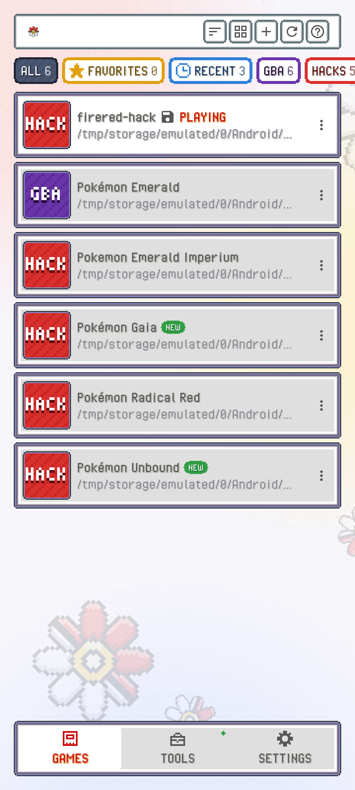

PokeDaisy works with two screens or one. With two, the game is on top and the companion below. With one, the companion slides in beside the game, and on a phone held upright it sits under it. This page covers each setup and the settings that go with it.

## Dual-screen handhelds

| Device | How it runs |
| --- | --- |
| AYN Thor | What PokeDaisy was made on. The companion is laid out for its bottom screen. |
| Retroid Pocket Duo Lite | Its bottom screen is squarer (4:3), so a few screens rearrange to fit: the Pokémon summary puts its types beside the icon, and `STATES` uses flatter screenshots. |
| Retroid Pocket Duo | Should work the same way; not yet tried on real hardware. |
| Anbernic RG DS | Should work with `SWAP SCREENS` on (see below); not yet tried on real hardware. Its screens are small (640 by 480), so the companion's text is a size smaller there, and a few screens squeeze: a move's power and PP sit beside its name, and `DEX` puts height and weight on two lines. |

The game always opens on the device's main display, with the companion on the other one, even if you start it from the bottom screen.

Taps on the bottom screen go to the companion, and the device's `BACK` button works as the companion's back (tap it to close whatever's open there). Hold `BACK` to leave the game.

Rather use your buttons down there? Press `X` while you walk around and they move to the companion, like a DS game's menu, until you press `X` again. See [X takes your buttons to the companion](controls.md#x-takes-your-buttons-to-the-companion).

### SWAP SCREENS

Some devices treat their bottom screen as the main display, which would put the game below and the companion on top. `SWAP SCREENS` trades them, so the game moves to the other screen and the companion takes the main one.

You'll find it in the `SCREEN` group of Settings on the top screen and of the companion's `SETTINGS`. It only shows on a device with a second screen. Flipped from the companion, it swaps right away; flipped from the top-screen Settings, the game picks it up when you go back to it.

### On a TV

Casting your phone to a TV (Smart View, screen mirroring) or plugging one in gives your device a second screen. PokeDaisy puts the game on the TV and keeps the companion on your phone, so you can play on the big screen with your party, bag and map in hand. Want it the other way round? Turn off `SWAP SCREENS`. A TV keeps its own choice, apart from a built-in second screen's.

### CLOSE COMPANION

Want the companion's screen for something else while you play, like a video or a chat app? At the very bottom of the companion's `SETTINGS`, under `CLOSE GAME` and `RESTART GAME`, tap `CLOSE COMPANION`. The game keeps running and the companion's screen is free for other apps. Press `BACK` on the game to bring the companion back.

With `SWAP SCREENS` on, the companion has the main screen, so that's the one you get back: the game stays on its screen, and you can keep playing it there, touch included, while you use another app on the main one. Your buttons go to whichever screen you touched last, so tap the game before you press a button for it.

Meanwhile the companion lives on the game's screen: tap `BACK`, the small button at the bottom of the right edge, or the HUD's `COMPANION` button and it opens over the game, filling that screen. `B`, `START` and the X close it again, as with the window on a one-screen handheld (see below). To put it back on the main screen, tap `OPEN COMPANION` at the bottom of its `SETTINGS`, where `CLOSE COMPANION` was.

> [!TIP]
> On the AYN Thor, set the Thor's own controller focus mode to Auto-Lock. Then the buttons follow whichever screen you touch: tap the game to play it, tap the other app to use it. With the focus locked to the top screen, the buttons keep going to the top screen's app even while you touch the game.

It's there on every two-screen device.

### SINGLE SCREEN

Rather play on one screen, so the other is free for good? Turn on `SINGLE SCREEN` (in the `SCREEN` group of Settings on the top screen and of the companion's `SETTINGS`; it only shows on a device with a second screen). The game stays on its screen, the second screen goes back to Android for any app you like, and the companion opens as a window over the game, the way it does on a one-screen handheld (see below). Tap `BACK` to open or close it.

Flipped from the companion, it switches right away and the window opens so you can see where it went. Turn it off and the companion goes back to the second screen. While it's on, `SWAP SCREENS` and `CLOSE COMPANION` step aside, and `COMPANION VIEW` and `BATTLE BUTTONS` show up, as on a one-screen device.

On an AYANEO handheld, PokeDaisy also opens an empty window on the bottom screen when a game starts, so AYANEO's own panel steps aside for the companion. Your buttons stay with the game.

## DS games

A DS has two screens, and so does a dual-screen handheld, so a DS game uses both the way the DS does: its top screen on your top screen, its touch screen on the bottom one. Tap the bottom screen with your finger wherever the game wants the stylus.

The companion is still there:

- **On the bottom screen:** tap `COMPANION` in the bar under the touch screen and the companion takes the touch screen's place. The bar takes a little of its height, so its text is a size smaller there, as on a small screen. Tap `GAME SCREEN` in the same spot to bring the touch screen back. `BACK` with nothing left to go back from also returns to the touch screen. PokeDaisy remembers which of the two you had.
- **Over the game:** tap `BACK` and the companion opens over the top screen, as on a one-screen handheld (see [The window](#the-window)).

Rather have the touch screen fill your whole bottom screen, without the bar? Set `DS TOUCH SCREEN` to `STRETCH` in SETTINGS (SCREEN group). The touch screen is stretched a little taller then, and `COMPANION` becomes a small tab on the right edge, halfway down, where the games keep nothing you need to tap. It works the same way: tap it for the companion, and tap it again there for the touch screen.

`SWAP SCREENS` trades a DS game's two screens too: the top screen goes on your bottom screen, and the touch screen, with its `COMPANION` button, on the top one. The touch screen stays up whatever `CLOSE COMPANION` says. `REWIND` isn't available in DS games.

On a handheld or phone with one screen, a DS game shows both of its screens on it. Held upright, the touch screen sits under the game, where the companion would be. Its `COMPANION` button swaps it for the companion (and `GAME SCREEN` brings the touch screen back), the same switch as on a dual-screen device.

### DS layout: two screens on one

Held sideways, `DS LAYOUT` (in the `SCREEN` group of Settings and of the companion's `SETTINGS`) picks where the two screens go. Each choice has a little picture of how it looks:

- `ONE SCREEN` (the default): the game fills the screen, with `EXPAND` if `ASPECT` says so, and the touch screen floats in over it whenever the game wants it: when you press X for the game's menu, in a battle's bag, party and questions (the party after one of yours faints too, the one you switch to after a trainer's Pokémon faints, picking a move to forget for a new one, and the naming screen after a catch), when you name yourself and your rival at the start of a new game, and whenever the top screen goes blank while the touch screen has something (like the title's `CONTINUE`). The game dims behind it, like a pop up on a web page, and keeps running. When the game brings it up (outside a battle), the picture behind it stays as it was when it came, until it goes, so nothing jumps around behind it as the game moves between its pages. When the game is done with the touch screen, it goes away by itself. When the game goes from one screen to the next (into a menu screen and back out), both screens keep the picture you tapped on, shaded a little with three dots bouncing on it, while the game runs at full speed behind it with its sound off (with fast forward on, at fast forward's speed, music and all). The next screen fades in over it once it's ready, so you never sit through the game's fades and the black between them. Your taps and buttons wait until then. Leaving a menu screen with its own back or quit button brings you back to the X menu, as B does. Tap the dim beside it to close it: the game gets B, its own way back (not in a battle). The first page of the party, the Pokédex and the options floats in alone the same way, over the field you came from. Pages with something to say on both screens (a Pokémon's summary, the Pokédex list, the bag, the Pokégear and the rest) show side by side over it instead, edge to edge. A battle gets the game's buttons on the top screen (see [Battle](battle.md#on-one-screen-battle-buttons)).
- `SIDE BY SIDE`: both screens at the same size, next to each other like an open DS.
- `LARGE + SMALL`: the game large, the touch screen small beside it, level with its bottom edge. The HUD moves its buttons to the bottom left and your party under the minimap, in two columns.
- `PICTURE IN PICTURE`: the game fills the screen, the touch screen small in its bottom right corner, framed in white. The HUD moves its buttons to the bottom left and your party under the minimap, to keep the corner clear. When the game wants it, it floats in large instead.
- `STACKED`: the game above its touch screen, as you hold a DS.

To switch layouts while you play, press R2 (the `DS LAYOUT` hotkey, see [Hotkeys](controls.md#hotkeys)): each press steps to the next one. Wherever the screens leave room, the game itself fills it, blurred, never black bars, also where `EXPAND` has nothing to draw past the game (the title, a menu screen). Tap the touch screen with your finger in any layout.

To bring up the touch screen yourself in `ONE SCREEN` or `PICTURE IN PICTURE`, tap `TOUCH` on the [HUD](hud.md), or press L2 (the `TOUCH SCREEN` hotkey, T on a keyboard). Close it with its X, the same button again, or `BACK`. Taps beside the window still reach your touch controls.

HeartGold and SoulSilver (the USA releases), Platinum, Black, White, Black 2 and White 2 are the games PokeDaisy follows this closely so far, each its own way:

- **Platinum** opens its X menu, its party and its options on the top screen, so those stay on the game alone. The bag, the trainer card and the Pokédex show side by side, and a battle's bag, party and questions float in, as do the party after one of yours faints, picking a move to forget and the naming screen after a catch.
- **Black, White, Black 2 and White 2** put their X menu on the touch screen, so it floats in when you press X, and so does its save question. The party, the trainer card and the options float in alone; the bag (the item you pick shows on the top screen) and the Pokédex show side by side. A battle's bag, party and questions float in, as does the party after one of yours faints.

In the German HeartGold and SoulSilver, `ONE SCREEN` keeps the touch screen small in the corner, as `PICTURE IN PICTURE` does, so it's always there.

In Origin HeartGold, `ONE SCREEN` floats the touch screen in for its X menu, its options and its battles: its battle system is its own, so its battle buttons aren't on the top screen. Whenever a battle waits for you (your moves, your party), its touch screen floats in and you tap the game's own buttons on it. While the battle plays, the game fills the screen again. The companion's `BATTLE` tab still shows the matchups.

## Single-screen handhelds

On a handheld with one screen, like the Retroid Pocket 6, the companion shares the game's screen. The `COMPANION VIEW` setting (in the `SCREEN` group of Settings and of the companion's `SETTINGS`) picks how:

- `WINDOW` (the default): the companion opens as a window in the middle of the screen, over the game.
- `SIDE PANEL`: the companion is a panel on the right side of the screen, which you can lock beside the game.

Flipped from the companion, it switches right away.

Rather not see the small button at the bottom of the screen's right edge? Turn off `COMPANION BUTTON`, right under `COMPANION VIEW`. `BACK` and the HUD's `COMPANION` button still open the companion.

On a tall screen, about 2.5 inches high or more like the Retroid Pocket 6, the companion's text is a little smaller in the window, so more fits on each page. On a tablet the window stops at about a handheld's size, and so do the HUD's map and a Pokémon's summary, so the game still shows around them.

### The window

- **Open it:** tap `BACK`, or tap the small button at the bottom of the screen's right edge.
- **Use your buttons:** while the window is open, your controls work the companion instead of the game. The D-pad moves the cursor and `A` picks what it's on, the way the game's own menus work. `L` and `R` move between the tabs, and `B` goes back. When there's nothing left to go back from, `B` closes the window. `START` closes it from anywhere. Your buttons follow your `GAME BUTTONS` settings, so if you moved `A` and `B`, the window follows.
- **Close it:** press `B` or `BACK` until it closes, press `START`, tap the X at its top right, or tap anywhere outside it.

In the bag, moving the cursor shows each item's description, and `A` on the item goes to its `USE` and `GIVE` buttons. In a battle, the window's `BATTLE` tab shows `INFO` and `SUGGESTIONS` only, without the battle buttons: close the window and pick your move in the game's own menu. `FLY` on the map closes the window, so you see the flight.

On the `MAP`, the D-pad moves the map's own cursor from place to place and names each one, like the game's Town Map. Go past the map's edge toward its buttons to reach `PLACES`, `FLY` and the rest. In `GUIDE`, moving down the page list shows each page, and `A` on an entry shows its hint, then its answer. Pages with nothing to pick, like a Pokédex entry's `MOVES`, scroll with the D-pad once the cursor is on them. On the `CARD`, `A` flips it.

The game keeps running behind the window, dimmed. It just doesn't get your button presses until you close the window, and then they go straight back to the game. A button you're still holding as the window closes doesn't count in the game until you let go of it.

Small `L` and `R` keys at both ends of the tab bar remind you which buttons change tabs. You can tap them too.

### The side panel

- **Open it:** tap `BACK`, or tap the small button at the bottom of the screen's right edge. The panel slides in over the game.
- **Close it:** with the panel open, `BACK` works as the companion's back. Once there's nothing left to go back from, the next `BACK` closes the panel. There's also a close tab right outside the panel's bottom-left corner.
- **Lock it beside the game:** tap the padlock tab on the panel's left edge. The game moves over to make room, and both stay on screen as you play. Tap the padlock again and the panel goes back to sliding over the game. A locked panel stays open when you press `BACK` with nothing to go back from, and it comes back the next time you start a game.
- **Resize it:** drag the padlock tab sideways. The panel starts at half the screen, which shows the game at exactly 4x on a 1080p screen. While you drag, it snaps when the game lands close to a whole-number size, so the pixels stay even.

While the panel is locked, the open and close tabs turn see-through so they don't get in the way. The touch controls stay on the game's side whenever the panel is open.

Hold `BACK` to leave the game, as always.

> [!TIP]
> On a controller, an unbound **HOME** or guide button works like a `BACK` tap, so you can open and close the companion without reaching for the screen.

## Phones held upright

Hold a phone upright and the game sits across the top of the screen, with the companion docked below it and the touch controls under that. It's open until you hide it: there's nothing to slide in. In a DS game the touch screen takes the companion's place, between the top screen and the buttons.

- **Change its height:** drag the grip on the companion's top edge up or down. It snaps to the default size (the shape of the Thor's bottom screen) and to the largest size (everything under the game).
- **Step through sizes:** tap the grip to go from small, to the default, to everything under the game, then to hidden, and round again.
- **Hide it:** with the companion hidden, the game has the screen to itself and only the grip stays, along the bottom. Tap it, drag it, or press the `COMPANION` hotkey to bring the companion back.
- **Touch controls:** they get the space at the bottom of the screen, under the companion. With the companion `AT BOTTOM` (below) they go in the gap between the game and the companion when there's room, and lie over the game when there isn't. The phone held upright has its own layout, and `POSITION` on the `TOUCH CONTROLS` page puts the buttons at the top, middle or bottom of their space; see [Touch controls](controls.md#touch-controls).

The `COMPANION` setting (on the `DISPLAY OPTIONS` page of the `SCREEN` group, on single-screen devices) picks where the companion sits on a phone held upright:

- `UNDER GAME` (the default): right under the game, with the touch controls at the bottom of the screen. On a screen with no room to spare under the companion (a tablet, or a DS game's taller picture), the companion and then the game get a little smaller so the touch controls still have their own space at the bottom and never cover the game.
- `AT BOTTOM`: along the bottom of the screen, with the touch controls in any gap above it.

With `ASPECT` set to `EXPAND`, the game fills everything above the companion, so both would look the same. There `UNDER GAME` gives the touch controls a strip of their own along the bottom of the screen, under the companion, so they don't lie over the game. When the touch controls aren't showing (you're using a controller), the setting is greyed out.

## Folding phones

On a folding phone, PokeDaisy uses the fold the way a two-screen handheld uses its two screens. It switches as soon as you fold or unfold, mid-game.

- **Half open like a laptop** (the fold across the screen, the bottom half resting on a table): the game is on the top half and the companion fills the bottom half. In a DS game the touch screen takes the bottom half, like on a DS, with its `COMPANION` switch to bring the companion up. With no controller, the touch controls sit on the top half, beside the game.
- **Half open like a book** (the fold down the middle): the game is on the left page and the companion on the right. `BACK` goes back inside the companion, and the companion stays open.
- **Fully open or closed:** the usual layouts for one screen, sideways or upright, as above.

The `FOLD LAYOUT` setting (in the `SCREEN` group, on both screens) turns this on or off. It's on to start with, and it only shows up once your phone has reported a fold. Off, a half open phone gets the same layout as a flat one.

## Rotating the device

On a device with one screen, PokeDaisy follows the way you hold it. Turn it sideways and you get the window or the side panel; turn it upright and you get the docked companion. It switches as you rotate, mid-game.

With a second screen, PokeDaisy stays in landscape.

## Where things are on each screen

- **Top screen (or your only screen):** the library, Settings, the manual and the game itself.
- **Companion:** the game's tabs and its own `SETTINGS`, which holds the options you're likely to change mid-game. Things that need typing, like a RetroAchievements sign-in or cheat codes, live in the top-screen Settings, since the bottom screen can't host a keyboard well.

[The companion](companion.md) explains the tabs, and the [settings reference](settings-reference.md) lists which setting is on which screen.
