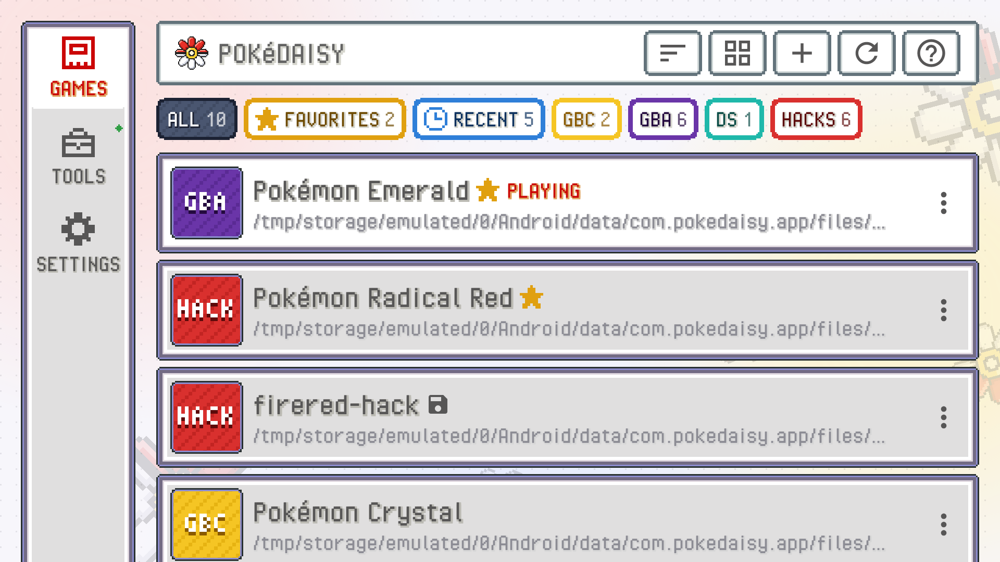
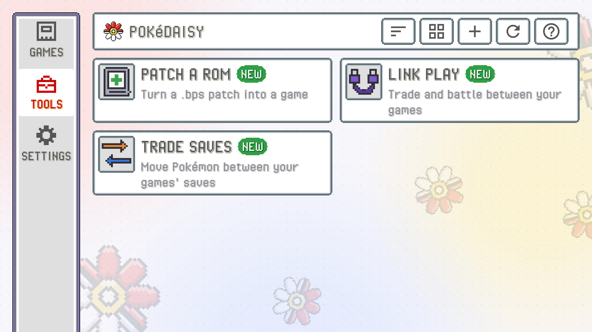
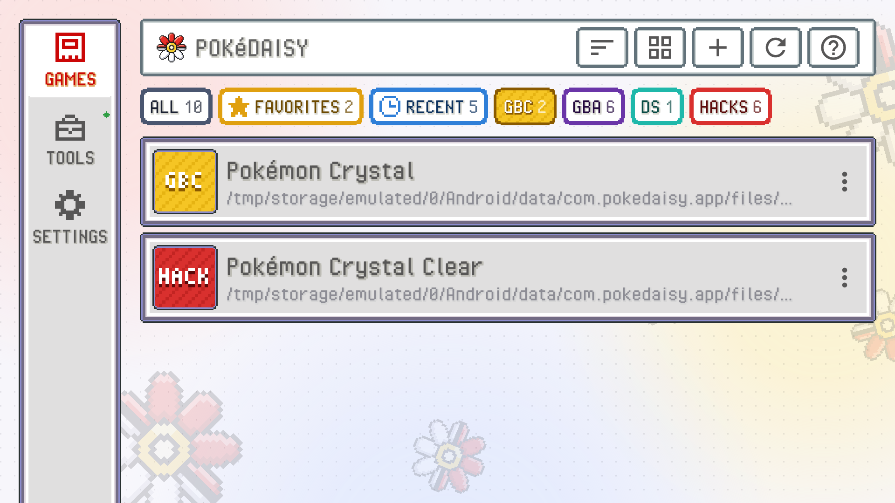
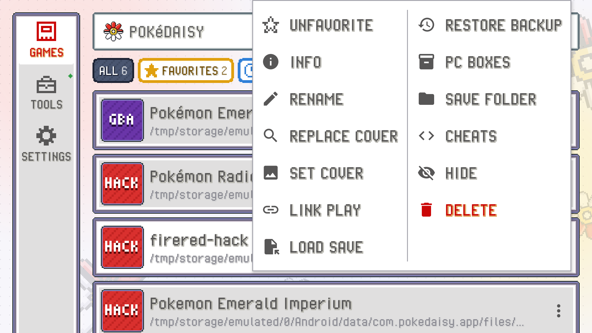
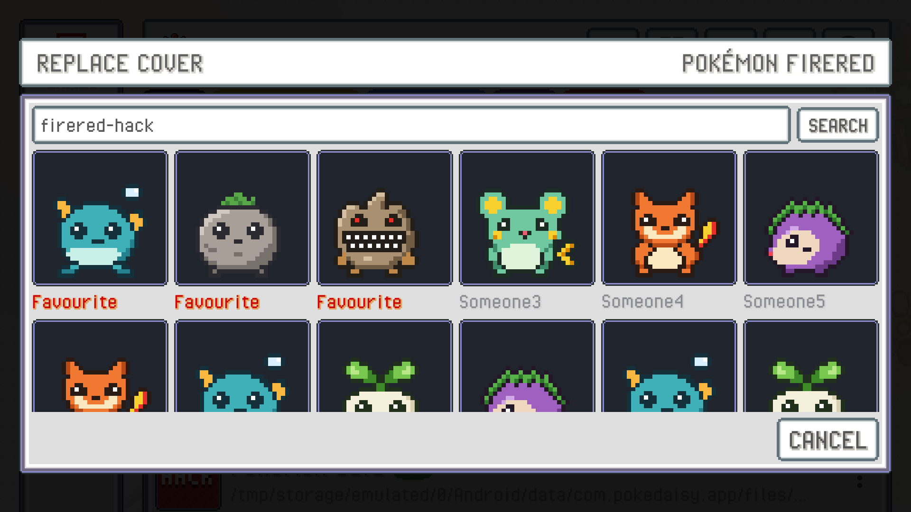

The library is the first thing you see when you open PokeDaisy: every game you've added, in the order you pick. Tap a game to play it.

The first time you play a big game, like a DS game or one in a `.zip`, PokeDaisy reads it through before it starts, which can take a few seconds. The library dims and a little red and white ball rocks in the middle until the game opens; nothing else can be tapped meanwhile.

The buttons in the header, from left to right:

| Button | What it does |
| --- | --- |
| Sort | Picks the order of your games (see [Sorting](#sorting-and-favorites)). |
| Search | Finds a game by its name or file name (see [Searching](#searching)). |
| List / grid | Switches between a list (one game per row, with its file path) and a grid of covers. |
| `+` | Adds games: `ADD A ROM FILE`, `ADD A ROMS FOLDER`, `MANAGE ROMS FOLDERS` or `PATCH A ROM` (see [Adding games](#adding-games)). |
| Refresh | Looks through your ROMs folders again and tells you what it found. |
| `?` | Opens this manual. |

The game you have open says `PLAYING`, and a small save icon next to a name means it has a save file.

## Games, tools and settings

Down the left edge of the library are three buttons: `GAMES`, `TOOLS` and `SETTINGS`. On a phone held upright they sit in a bar along the bottom edge instead. They stay on screen whichever one is open, and the page beside them changes.

- `GAMES` is your library, the games and the quick views over them.
- `TOOLS` shows, in the games' place, what PokeDaisy can do with your games besides playing them. Tap one to open it. Its header has only the help button, since sorting and adding are for your games.
- `SETTINGS` shows Settings in the same place, under the library's header. Tap `SETTINGS` again on one of its pages to go back to the first one, and `BACK` from there takes you to your games.

| Tool | What it does |
| --- | --- |
| `PATCH A ROM` | Turns a `.bps` patch into a game (see [Patch a ROM hack](#patch-a-rom-hack)). |
| `LINK PLAY` | Runs two to four GBA games joined as if by a link cable, to trade and battle between them (see [Link play](link-play.md)). |
| `SAVE EDITOR` | Opens a game's save: rearrange the PC, change the bag, money and moves (see [Save editor and save trades](save-trade.md)). |
| `TRADE SAVES` | Trades Pokémon between two of your games' save files (see [Save editor and save trades](save-trade.md)). |

A green dot on `TOOLS` means one of them is new. `BACK` on the tools takes you back to your games.

## Quick views

The row of coloured buttons under the header narrows the library down to one kind of game. Tap one to see only those games; the open one is filled with its colour. The number on each says how many games it holds.

| View | What it shows |
| --- | --- |
| `ALL` | Every game. |
| `FAVORITES` | The games you starred (see [Sorting and favorites](#sorting-and-favorites)). |
| `RECENT` | Every game you've played, the one you played last first, whatever the sort order. |
| `GB` | Game Boy games, like Red, Blue and Yellow. |
| `GBC` | Game Boy Color games, like Crystal, and the ones that also play on a Game Boy, like Gold and Silver. |
| `GBA` | Game Boy Advance games. |
| `DS` | Nintendo DS games. |
| `HACKS` | ROM hacks. |

The console views and `HACKS` use the same colours as the covers of games without art (see [Cover art](#cover-art)), and each one only shows while your library has such a game. A hack is in `HACKS` and in its console's view too, so a FireRed hack shows under `GBA` as well.

The library remembers the view you picked, also after you close the app. A view that has nothing yet tells you how to fill it.

## Adding games

There are three ways to get games into the library. Use whichever suits you; they mix fine. A ROM hack that comes as a patch is made into a game with [Patch a ROM hack](#patch-a-rom-hack).

### Link your ROMs folders

The easiest way if you already keep your games in folders. Link them in first-time setup, with `+` > `ADD A ROMS FOLDER` in the library, or in Settings > `FOLDERS` > `ROMS FOLDERS` with `ADD FOLDER`.

- You can link as many folders as you like. Linking just the ones with your games (say `ROMs/gba`, `ROMs/gbc` and `ROMs/nds`) is quicker to look through than one big folder that holds every system's games.
- Every supported game in them shows up in the library.
- Games are played right where they are. Nothing is copied, so they take no extra space.
- The folders are checked for new games every time you come back to the library. `RESCAN` (in `ROMS FOLDERS`) or the refresh button checks them now.
- `+` > `MANAGE ROMS FOLDERS` opens the list of linked folders, with how many games each one has. `REMOVE` takes a folder's games out of the library. Your files stay where they are.
- A folder inside one you already linked is already covered, so it isn't added twice. Link a folder that holds ones you linked before, and it takes their place.

Games in a linked folder are your own files, so the library never deletes them. Their menu has `HIDE` instead of `DELETE`.

### Import with +

Tap `+` in the header, pick `ADD A ROM FILE` and pick a game file. PokeDaisy copies it into its own games folder and adds it to the library. If the file is zipped, it's unpacked as it's imported.

If the companion can't read the game, you're told it's `NOT SUPPORTED` and asked whether to add it anyway: the game still plays, only the companion won't show its party, map, items or battles.

### Copy files into the app's folder

Games copied straight into `Android/data/com.pokedaisy.app/files/roms/` on the device (with a file manager or from a computer) show up too. Tap refresh in the library after copying.

### Patch a ROM hack

Most ROM hacks come as a `.bps` patch: a file that turns a game you already have into the hack. PokeDaisy can apply it for you.

1. Tap `+` and pick `PATCH A ROM` (it's also under `TOOLS`), then pick the `.bps` file. Picking a `.bps` with `ADD A ROM FILE`, or opening one with PokeDaisy from a file manager, does the same.
2. PokeDaisy reads the patch and looks through your library for the game it was made for. A patch names that game by its checksum (CRC32, a fingerprint of every byte), so it finds the right file whatever it's called, zipped ones too. You don't pick it yourself.
3. When it's found, you see the patch, the game it goes on and where the patched game will be saved. Tap `APPLY PATCH` and a bar shows how far along it is.
4. When it's done, you're told where the new game is. If the companion can read it, it's in your library right away and `PLAY` starts it.

Your original game is never changed: the patched game is a new file, named after the patch (`My Hack.bps` makes `My Hack.gba`). It goes with your other games of its kind: a linked folder called `gba`, `gb`, `gbc` or `nds`, else the folder the original game is in, else PokeDaisy's own games folder. If a file with that name is already there, the new one gets a number (`My Hack (2).gba`); the same patched game made before is just kept.

If you see `BASE ROM NOT FOUND`, none of your games has the checksum the patch wants. The message says which game it is when PokeDaisy knows it (an exact version, such as the first or second release of FireRed). Add that game to your library or a ROMs folder, then try again. Most hacks want a clean, unmodified US FireRed or Emerald: a game that was already patched, or another language or version, has a different checksum.

If the companion doesn't support the patched game, you're told so and it stays out of the library, but the file is still saved. `ASK FOR SUPPORT` asks for the game to be added. If it was saved in PokeDaisy's own games folder, Settings > `HIDDEN GAMES` can still show it in the library.

### File types

- `.gba` files, and Game Boy / Game Boy Color `.gb` and `.gbc`.
- Zipped games, `.zip` or `.7z`. In your ROMs folder they stay zipped: PokeDaisy reads the game out of the archive when you play it. A zipped game's save is named after the game inside the archive, the way RetroArch does it.

## Game names

PokeDaisy recognizes the games it supports and shows their proper names ("Pokémon FireRed", "Pokémon Unbound") whatever the file is called. Other games show their file name, tidied up: dump tags like `(USA, Europe)` and numbering are dropped.

To call a game something else, use `RENAME` in its menu. It only changes what the library shows; the file keeps its name, so its save is still found.

Prefer your own file names? Set `GAME NAMES` to `FILE NAME` in Settings, in the `LIBRARY` group.

## Searching

Tap the search button in the header and start typing. The games behind the window follow what you type, by the name the library shows or by the file name. Case and accents don't matter, and the words can come in any order, so `red fire` finds FireRed.

Tap `DONE` to go through what's left, and the search stays on top of the list. Tap `CLEAR` there or press BACK to see all your games again.

## Sorting and favorites

Tap the sort button and pick under `SORT BY`:

- `NAME`: A to Z.
- `LAST PLAYED`: the game you played most recently first. Games launched from a frontend count too.
- `DATE ADDED`: the newest arrivals first.

Favorites always come first, whatever the order. To make a game a favorite, open its menu and tap `FAVORITE` at the top; it gets a gold star next to its name. `UNFAVORITE` takes it off.

A game that appeared in the last 24 hours wears a green `NEW` tag. Games that were already in your library when you set PokeDaisy up (or when you linked a folder) don't get one, so the tag only marks real arrivals.

## The game menu

Long-press a game, in the list or the grid, to open its menu. In list view, the three dots at the end of a row open it too.

| Entry | What it does |
| --- | --- |
| `FAVORITE` / `UNFAVORITE` | Pins the game to the top of the library with a gold star, or takes it off. |
| `INFO` | Everything about the game, its save and its save states (see [Game info](#game-info)). |
| `RENAME` | Changes the name the library shows. |
| `REPLACE COVER` | Opens the cover picker (see [Cover art](#cover-art)). |
| `SET COVER` | Uses an image from your device as the cover. |
| `RESET COVER` | Goes back to the automatic cover. Only shows after you picked one yourself. |
| `LINK PLAY` | Runs this GBA game with up to three others, joined as if by a link cable. See [Link play](link-play.md). |
| `SAVE EDITOR` | Opens the game's save: rearrange the PC, change the bag and moves, or trade with another game's save. See [Save editor and save trades](save-trade.md). |
| `LOAD SAVE` | Puts another save file into the game. Your current save is kept as a dated copy. |
| `RESTORE BACKUP` | Brings back one of the automatic save backups. |
| `SAVE FOLDER` | Gives this game its own save folder, such as another emulator's. |
| `DEFAULT SAVE FOLDER` | Goes back to the usual save folders. Only shows after you set a `SAVE FOLDER`. |
| `CHEATS` | Opens the game's cheat codes in Settings. See [Cheats](cheats.md). |
| `ADD TO HOME` | Puts a shortcut to the game on your device's home screen. A tap on it starts the game straight away. |
| `HIDE` | Takes the game off the library without touching any files. |
| `DELETE` | Deletes the game file. Saves and save states are kept. Only for imported games, never your linked folder's. |

`LOAD SAVE`, `RESTORE BACKUP` and `SAVE FOLDER` are explained in [Saves, backups and save states](saves.md#load-a-save-file).

With the device held upright, or if the menu doesn't fit the screen's height, it spreads over two columns.

## Hidden games

`HIDE` is for games you want out of the way, like a hack you've finished or a duplicate. The game disappears from the library, but its name, cover and saves are all kept.

To bring one back, open Settings > `HIDDEN GAMES` and tap the game (`SHOW`), or tap `SHOW ALL`.

## Cover art

Covers come from two free services, and you need your own free key for each one you want to use. Add them in first-time setup or in Settings > `COVER ART`:

- `RetroAchievements WEB API KEY`: square box art for every game that has an achievement set. This is tried first.
- `SteamGridDB API KEY`: icons for FireRed, Emerald and the supported hacks, used where RetroAchievements has no art.

Tap `GET KEY` next to either one to open the page where your key is, copy it, paste it in the box and tap `SAVE`. PokeDaisy fetches a cover for each game once and keeps it on the device. `REPLACE ALL` fetches fresh covers for every game, replacing the ones you have (including ones you picked yourself). `CLEAR` removes the keys.

A game with no cover shows what kind of game it is instead, in pixel letters on its own colour: `GB` (grey) for a Game Boy game, `GBC` (yellow) for a Game Boy Color only one, `GBA` (purple) for a Game Boy Advance game, `NDS` (teal) for a DS game, or `HACK` (red) for a ROM hack.

### Pick another cover

Don't like the cover a game got? Open its menu and tap `REPLACE COVER`. The picker shows every icon it found for the game; tap one to use it. If the game isn't found under its name, type another name in the search box and tap `SEARCH`. You need a key saved for the picker to find anything.

To use your own image instead, tap `SET COVER` in the menu and pick a picture from your device.

## The dual-screen launcher

On a device with two screens, the library is made for buttons. It's the same library: `GAMES`, `TOOLS` and `SETTINGS` down the left (see [Games, tools and settings](#games-tools-and-settings)), the [quick views](#quick-views) at the top, then the open view's games as a list or a grid (the view button in the header switches), each row with where its file is.

The D-pad moves a cursor through it: up and down a row, left and right along a row of the grid. Up from the top of the list reaches the quick views: left and right open the next view, and down, A or B go back to the games. Up once more reaches the header's buttons (sort, view, import and the rest); A presses one, down or B goes back. Left from the header's first button, the first quick view or the grid's first column reaches `GAMES`, `TOOLS` and `SETTINGS`: up and down pick one, A opens it, right or B goes back. On `TOOLS` the D-pad moves between the tools, A opens one, and B or `BACK` returns to your games. L and R jump a page. A small legend in the corner reminds you of the rest:

- **A** opens the game.
- **B** opens the game's menu (the same entries as a long press). Whatever an entry opens, like `INFO`, B takes you back to the menu.
- **Y** opens Settings.

On a screen held upright the legend floats just above the bar of `GAMES`, `TOOLS` and `SETTINGS`, so it never covers them.

With the touch screen, a tap on a game opens it straight away, and a long press opens its menu.

Prefer the library without the cursor and legend? Turn off `DUAL-SCREEN LAUNCHER` in Settings, in the `LIBRARY` group.

## Game info

`INFO` in a game's menu shows what PokeDaisy knows about it, in sections:

- **GAME**: its name, which game it was recognized as, whether the companion supports it (`SECOND SCREEN`), when you last played it and where its cover came from.
- **ROM**: the file, its folder, where it came from, its size and the game code from its header.
- **SAVE FILE**: where the save is (or where it will be, before the game's first save) and how many backups there are.
- **SAVE STATES**: how many of the 10 slots are used, the newest one and the resume state.
- **RetroAchievements**: whether the game has an achievement set, and how many you've earned if you're signed in.

For a game the companion doesn't support, `ASK FOR SUPPORT` opens a game request on the PokeDaisy website with the file's name, size and fingerprint filled in. The ROM itself is never sent.

## Supported, partly supported and not supported

Every game plays, but the companion only reads the games it knows. The library tags the rest:

- `NOT SUPPORTED`: the game plays, and the companion shows a notice instead of its tabs.
- `PARTIALLY SUPPORTED`: a ROM PokeDaisy matched to a game it knows. The party, bag, map and battles work, and whatever didn't match is switched off.

From a linked folder, the library lists the supported games plus any unsupported hacks of FireRed, LeafGreen, Emerald, Ruby or Sapphire (tagged), so you can try them. When PokeDaisy can't tell which game a ROM is built on, `INFO` has `PICK A GAME` to tell it, and `FORGET MATCH` to undo a match. [Supported games](supported-games.md) has the full list and explains how matching works.

Turn on `SUPPORTED ONLY` in Settings, in the `LIBRARY` group, to leave games the companion can't read out of the library.

## Supporting PokeDaisy

PokeDaisy is free, has no ads and is made by one person. After you've played for a good while, the library asks once whether you'd like to support it, with `BUY ME A COFFEE`, `PATREON` and `KO-FI`. Pick one and your browser opens that page. `REMIND ME LATER` (or BACK) asks again a few hours of play later, and `NO THANKS` means it never asks again. Picking a site counts as an answer too.

To know when to ask, PokeDaisy counts how long your games have been running. That count stays on your device and is never sent anywhere.

## Using a D-pad or controller

The library works without touching the screen. Move with the D-pad; the selected game or button gets an orange outline. Press up from the top row of games to reach the quick views, and up again for the header's buttons.

## Launching from a frontend

If you use a frontend like **ES-DE**, **iiSU** or **Cocoon** to browse all your games, it can start your games straight in PokeDaisy, skipping the library. When you leave the game (hold `BACK`, or the exit hotkey), you're back in the frontend.

Cocoon already knows PokeDaisy for GBA, Game Boy, Game Boy Color and DS games, zipped ones too. If it isn't offered, or Cocoon says `Incompatible Player` for a zipped game, refresh Cocoon's platforms (in its settings, under Library & Data) and pick PokeDaisy as the player.

In other frontends, add PokeDaisy as a custom or standalone emulator for each system with these values:

| Field | Value |
| --- | --- |
| Package | `com.pokedaisy.app` |
| Activity | `com.pokedaisy.app.LaunchActivity` |
| Action | `android.intent.action.VIEW` |
| Data | the ROM (the frontend's ROM placeholder) |

A few things to know:

- With All files access allowed, the game is played from where the frontend keeps it. Otherwise it's copied into PokeDaisy's games folder once and reused after that.
- Saves are found by the ROM's file name in your save folders, as usual. To share saves with the frontend's emulator, add its save folder in Settings > `FOLDERS` (see [Saves, backups and save states](saves.md#where-your-saves-live)).
- Starting another game from the frontend while one is open switches to it; the open one is suspended first.

There are step-by-step guides for [ES-DE](https://github.com/lidor30/pokedaisy/blob/main/docs/es-de/README.md) and [iiSU](https://github.com/lidor30/pokedaisy/blob/main/docs/iisu/README.md).
