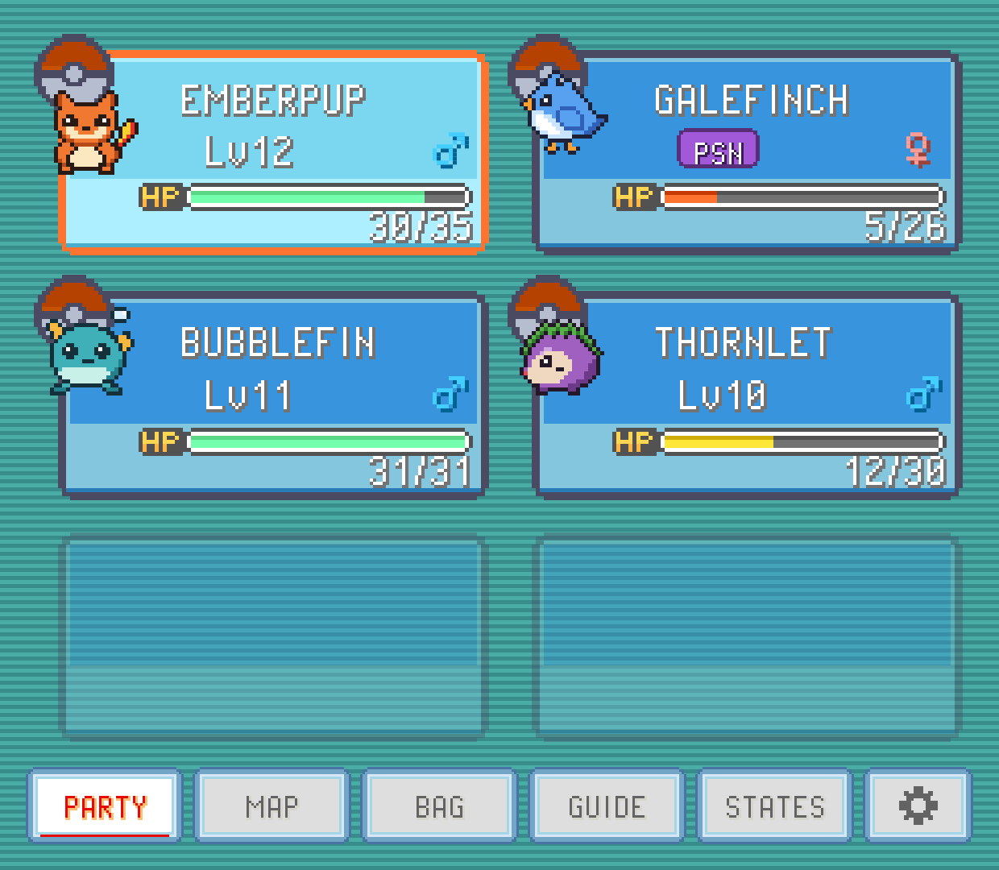
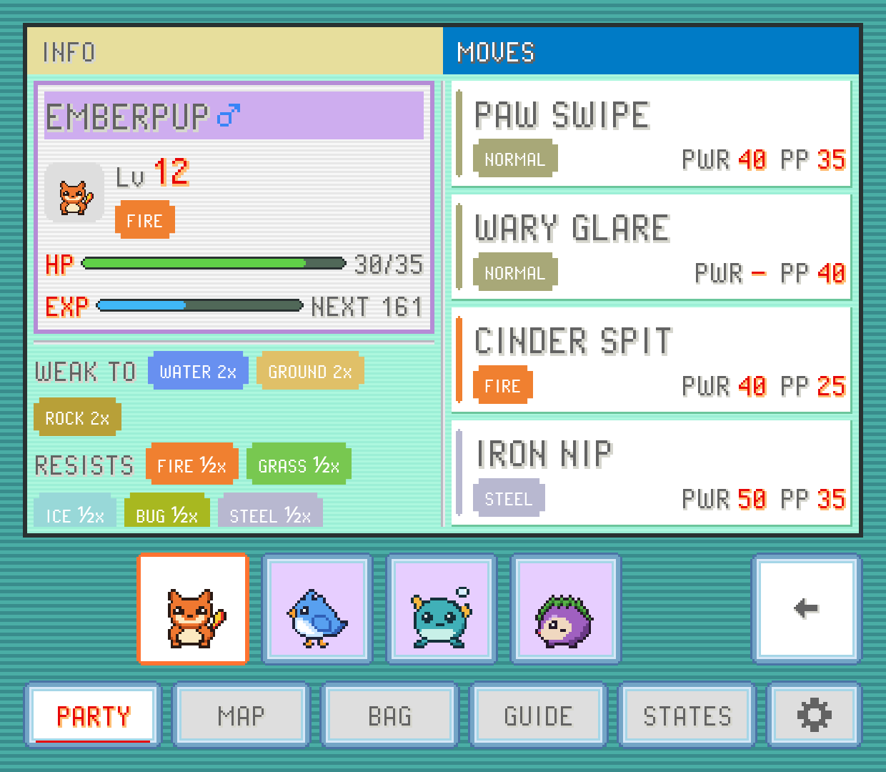

The `PARTY` tab is your team, live. Glance down and you know who's hurt, who's poisoned and who's about to level up, without pausing to open the game's menu.

## Your party

Each Pokémon gets a slot with its icon, name, level and HP bar, plus its status if it has one (poisoned, asleep and so on). A nicknamed Pokémon shows its nickname, in its slot and its summary, just as the game does; one without a nickname shows its species name. A fainted Pokémon's slot changes colour the way the game shows it.

A Pokémon holding an item gets a small tag in its slot's top right corner with the item's icon and name, so you can see who holds what without opening each summary. The game's own little held-item marker sits by its icon too.

The slots are your game's own party screen: FireRed and Emerald use their real slot art, and many hacks have their own colours. Games without a look of their own get a FireRed-style slot. The art is rebuilt from your own ROM the first time you play it, so it can take a moment to appear the very first time.

The icons bounce like they do in the game. If you'd rather they stood still, turn off `PARTY ICONS MOVE` in SETTINGS > `TWEAKS`.

## The summary

Tap any slot to open that Pokémon's summary. It fills the tab:

- **Top left**: name, gender, icon, level, status, types, the HP bar, and an EXP bar. `NEXT` is how much experience it still needs for the next level (`MAX` at level 100).
- **Bottom left**: `WEAK TO`, `RESISTS` and `IMMUNE TO`, with the multiplier on each type (2x, ½x, 0x and so on). It's the quickest way to see what to keep this Pokémon away from.
- **Right**: its four moves, each with its type, power (`PWR`) and remaining `PP`.

If the Pokémon holds an item, its `ITEM` line shows it. In games where the companion can use items, a `TAKE` button puts the item back in your bag, after asking first. When the bag has no room for it, the line says `BAG FULL` instead, just as the game would refuse.

Along the bottom is a strip with every Pokémon in your party: tap another one to switch to its summary. The page you're on (moves, stats or learn) stays put while you switch, so you can compare the whole team's IVs one after another. The blue button at the bottom right, or BACK, returns to the party.

## STATS: IVs, EVs and nature

Tap `STATS` to swap the moves for the numbers behind them, including the ones the game never shows you:

- Each stat's current value, its **IV** (0 to 31, as a bar that turns gold at a perfect 31) and its **EV**, with totals underneath.
- `NATURE`, with the stat it raises marked in red and the one it lowers in blue.
- `HIDDEN POWER`: the type that move would have for this Pokémon, and its power in FireRed, Emerald and the other original games.

Tap `MOVES` to go back to the moves.

The stats shown are the ones the game stored, which it only recalculates on a level up. So right after a battle where your Pokémon earned EVs, a stat can read a point lower than it will be after the next level.

`STATS` appears for most games. A few, where the numbers can't be read reliably yet, don't have it.

## LEARN: which moves are worth it

Tap `LEARN` to see what this Pokémon could learn soon, and whether it should. Its current moves move to the left, and the right side lists:

- `NEXT LEVELS`: the next moves it learns by leveling up, with the level for each.
- `TMs IN THE BAG`: the TMs and HMs you're carrying that it can learn.

Each entry shows the move's type, power, accuracy (`ACC`) and PP, and a verdict:

| Verdict | Meaning |
| --- | --- |
| `LEARN` | It has a free move slot. Take it. |
| `FORGET` and a move name | Worth learning, in place of that move. |
| `SKIP` | Not better than what it already knows. |
| `LEARNED` | It already knows this one. |

Tap an entry to see why. The reasons are short and specific, such as `NEW 2x ON` and the types it would start hitting hard, `YOUR TYPE: x1.5`, `ACCURACY 70%`, or that the move runs on its weaker attacking stat. The move it would replace gets a red `FORGET` tag on the left, so you can see exactly what you'd give up. Tap the entry again to close it.

A few rules behind the verdicts:

- A move has to be clearly better to be worth a swap. A tiny gain is a `SKIP`.
- HMs are never suggested for forgetting, and an HM is only suggested for learning when it's worth a lot more, because it's hard to get rid of afterwards.
- It weighs damage against every type, not one opponent, so it's advice for your team in general rather than for the next fight.

> [!NOTE]
> `LEARN` works in FireRed, LeafGreen, Ruby, Sapphire and Emerald (the original games) so far. Hacks change too many moves for the advice to be right there yet.

The verdicts follow `BATTLE HINTS` in SETTINGS. With it off, `LEARN` still lists what the Pokémon can learn and the move details, but without the verdicts and reasons.

You can also come at it from the other side: pick a TM in the [Bag](bag.md) to see which of your Pokémon can learn it.
