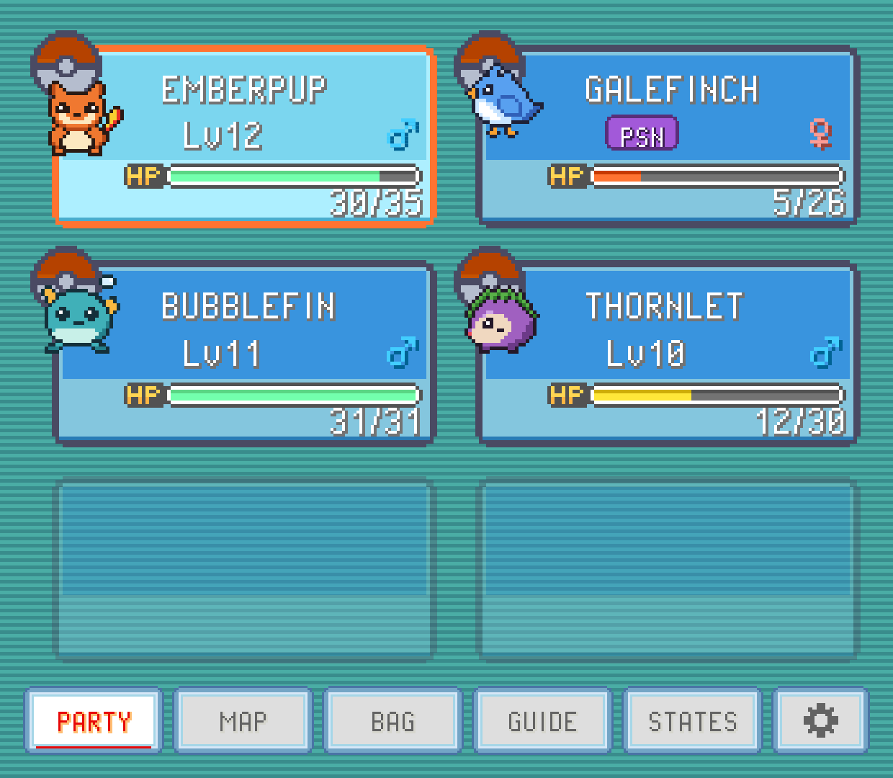
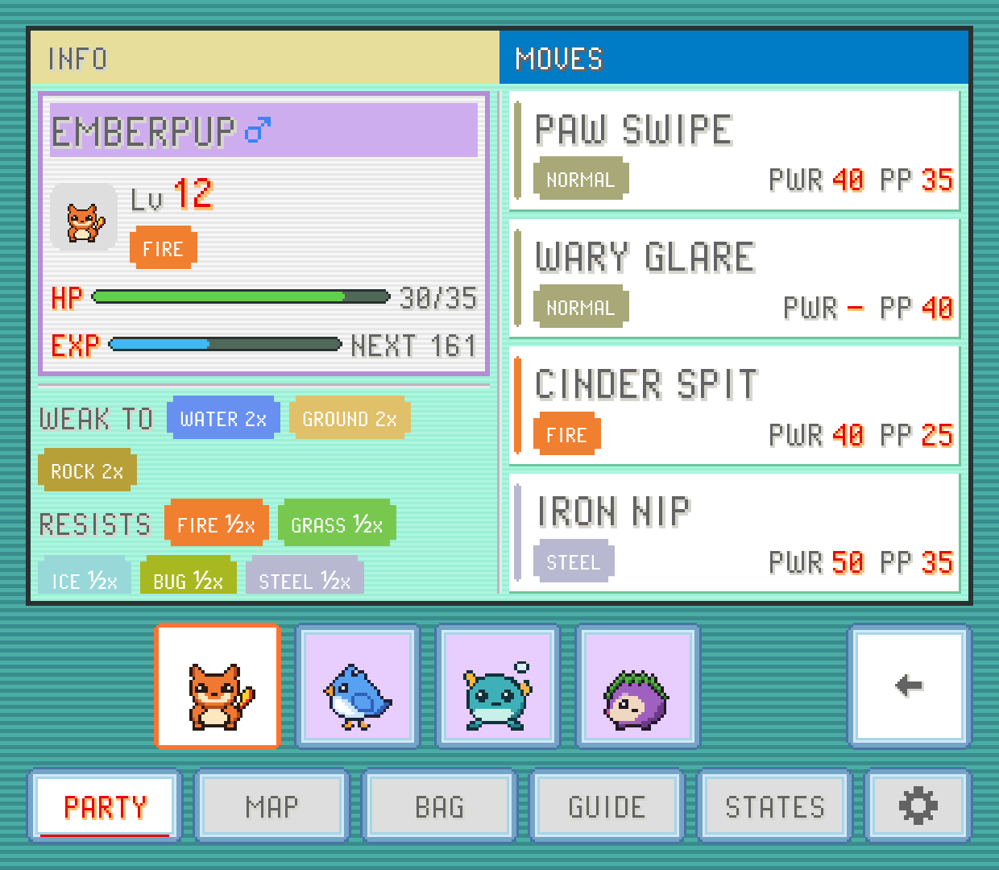

The `PARTY` tab is your team, live. Glance down and you know who's hurt, who's poisoned and who's about to level up, without pausing to open the game's menu.

## Your party

Each Pokémon gets a slot with its icon, name, level and HP bar, plus its status if it has one (poisoned, asleep and so on). A fainted Pokémon's slot changes colour the way the game shows it. The name is its nickname, as your game's own party screen shows it, on the Game Boy and Game Boy Advance games (the DS games show the kind of Pokémon for now). In SoulGold, whose party screen shows shiny Pokémon in their shiny colours, so does the icon here. In the original FireRed, LeafGreen, Ruby, Sapphire and Emerald (every language), and in the hacks [SHINY ODDS](controls.md#shiny-odds) lists, a shiny Pokémon's icon shows in its shiny colours too, here, in its summary and on the HUD, even though the games' own party screens don't: the colours are the shiny ones the game uses in battle, read from your ROM. Its summary marks it too: a gold sparkle after its name and a gold frame around its icon. In the Game Boy Color games (Gold, Silver, Crystal and their hacks) the party icons have no shiny colours, so a shiny Pokémon's slot gets that gold sparkle beside its level instead, and its summary marks it the same way.

A Pokémon holding an item gets a small tag in its slot's top right corner with the item's icon and name, so you can see who holds what without opening each summary. The game's own little held-item marker sits by its icon too.

The slots are your game's own party screen: FireRed and Emerald use their real slot art, and many hacks have their own colours. Games without a look of their own get a FireRed-style slot. The art is rebuilt from your own ROM the first time you play it, so it can take a moment to appear the very first time.

The icons bounce like they do in the game. If you'd rather they stood still, turn off `PARTY ICONS MOVE` in SETTINGS > `TWEAKS`.

### POKéMON PICTURES in Crystal

Pokémon Crystal's party screen has only a few dozen icons, shared by kinds that look alike, all in one colour, so a leafy starter and every other plant look the same. Set `POKéMON PICTURES` to `DETAILED` in SETTINGS (COMPANION group) and each slot shows that Pokémon's own picture instead, the one you see in battle and in the `DEX`, in its own colours, a shiny one in its shiny colours. The picture is read from your cartridge file like the rest of the game's art. The same pictures show everywhere else the companion and the HUD draw a Pokémon: the summary, battle `INFO`, the `DEX` list and its `EVOLVE` page, `GUIDE` and the HUD's wild Pokémon. `GAME`, the default, keeps the game's icons. The setting only appears while you play Crystal.

To change the order, press and hold a Pokémon, drag it onto another one and let go: they trade places, in your game too. The summary's `SWITCH` does the same: tap it, your party opens, and tap the Pokémon to trade with. `CANCEL` or BACK goes back to the summary. This works in the Game Boy Advance games while you're free to walk around, not in a battle or a conversation.

These controls also work in the supported English version of Pokémon Unbound. Changing party order is separate from choosing a Pokémon to send into battle.

## The summary

Tap any slot to open that Pokémon's summary. It fills the tab:

- **Top left**: name, gender (a nicknamed Pokémon's kind comes after its name), icon, level, status, types, the HP bar, and an EXP bar. An egg also shows the kind it will hatch into after `EGG`, with that kind's types; its `STATS` page has its IVs and the stats it will hatch with. `NEXT` is how much experience it still needs for the next level (`MAX` at level 100).
- **Bottom left**: `WEAK TO`, `RESISTS` and `IMMUNE TO`, with the multiplier on each type (2x, ½x, 0x and so on). It's the quickest way to see what to keep this Pokémon away from.
- **Right**: its four moves, the way the later handheld games list them: the type tag and the move's name on top, then an icon for its kind, its power (`PWR`) and `PP` left out of its most. The icon tells a physical move (a burst) from a special one (rings) and a status move (a grey dot), in the games where PokeDaisy knows the split. Tap a move for [its own page](#a-moves-own-page).

In games where the companion can use items, you can drag one of the four moves onto another to change their order: the move takes its PP and PP Ups with it, in your game too. Not in a battle or while a game menu is open. Save in the game to keep it.

If the Pokémon holds an item, its `ITEM` line shows it. In games where the companion can use items, a `TAKE` button puts the item back in your bag, after asking first. When the bag has no room for it, the line says `BAG FULL` instead, just as the game would refuse. Mail is the exception: `TAKE` sends the letter to your PC's mailbox instead of the bag, and says so if the mailbox is full.

### A move's own page

Tap a move in the summary and its page opens in the same window. The four moves stay down the left, the one on show lit, so you can tap through them. On the right, under a band in the move's type colour:

- `TYPE` with its kind (`PHYSICAL`, `SPECIAL` or `STATUS`), `POWER`, `ACCURACY` and `PP`, plus `PRIORITY` when the move goes before or after the others.
- `EFFECT`: what it does besides its damage, in plain words, with its chance where it has one ("10% chance to burn the target").
- `AGAINST TYPES`: the types it's super effective on, the ones it's not very effective on, and any it has no effect on.

`ACCURACY` and `EFFECT` come from the game's own move data, which PokeDaisy has for FireRed, LeafGreen, Ruby, Sapphire and Emerald. In other games those lines show a dash or stay off. BACK returns to the summary.

Down the right side is a column with every Pokémon in your party, the one on show framed in red: tap another one to switch to its summary. The page you're on (moves, stats or learn) stays put while you switch, so you can compare the whole team's IVs one after another. The blue button under the column, or BACK, returns to the party.

Tap the highlighted Pokémon again to open its Pokédex entry. That page's blue button, or BACK, returns to this summary; opening the `DEX` tab itself still starts at the list.

## DEPOSIT: into a PC box

In the games where the [BOXES tab](boxes.md) can move Pokémon, the summary has a green `DEPOSIT` button, like the game's own PC. Tap it, then pick a box from the list, which shows how full each one is. The Pokémon goes into that box's first free slot, right there in your game, and the rest of your party moves up. Back on your party you see it fly over to the box, then a message says where it went.

The game's own rules still apply: your last Pokémon that can battle has to stay, a Pokémon holding Mail can't go in until you take the Mail off, and a full box says so. You have to be walking around, with no battle, menu or text box open. **Save in the game** to keep it, just as you would after using a PC.

## Trade evolutions

Some Pokémon only evolve when traded, some of them while holding an item. If you have no one to trade with, turn on `TRADE EVOS` in the companion's `SETTINGS`, `GAMEPLAY` group (it's `OFF` until you turn it on). A Pokémon in your party that would evolve from a trade right now then gets an `EVOLVE` button on its summary. Tap it and confirm: the game plays its own evolution on the game's screen, as it would after a trade, and you're back where you were when it's done. The Pokémon stays yours, with your name on it.

The game decides, by its own rules: a Pokémon holding the item that stops evolution doesn't get the button, and one that needs a held item uses it up, as in a real trade. It works on the field, with no menu, text or battle open. **Save in the game** to keep it.

> [!NOTE]
> `TRADE EVOS` works in FireRed, LeafGreen and Emerald, in every language and release. In other games it shows `N/A`. To trade for real between two of your games, see [Link play](link-play.md).

## CENTER: heal, relearn, forget, rename

The services you'd normally walk to a town for are on every Pokémon's summary: tap `CENTER` (the pink button) and pick one.

- `HEAL THE PARTY`: the whole party back to full health, PP and status included, with the nurse's jingle. It's also a tile in the [quick menu](controls.md#the-quick-menu), `HEAL`.
- `RELEARN A MOVE`: the game's own screen for teaching this Pokémon a move it could have learned by now, as the move tutor does, free. It's only there when there's something to relearn.
- `FORGET A MOVE`: pick one of its moves and confirm, and it's gone, as the move deleter does it, field moves included.
- `NICKNAME`: the game's own naming screen for this Pokémon.

The games' own rules stay: an egg gets none of these, a Pokémon keeps at least one move, and only the trainer who caught a Pokémon can rename it, so one from a trade can't be renamed. The last Pokémon in your party that can cross water can't forget that move, unless [`NO HMS NEEDED`](controls.md#no-hms-needed) is on. Everything works out on the field, with no menu, text or battle open. **Save in the game** to keep the changes.

> [!NOTE]
> `CENTER` works in FireRed, LeafGreen, Emerald, Ruby and Sapphire (every language and release PokeDaisy supports) and in many hacks built on their code. In hacks that changed the naming screen (Unbound and other CFRU hacks), `NICKNAME` isn't offered. `RELEARN A MOVE` needs the game's move lists, which PokeDaisy reads for most games.

## STATS: IVs, EVs, nature and ability

Tap `STATS` to swap the moves for the numbers behind them, including the ones the game never shows you:

- Each stat's current value, its **IV** (0 to 31, as a bar that turns gold at a perfect 31) and its **EV**, with totals underneath.
- `NATURE`, with the stat it raises marked in red and the one it lowers in blue. Monomyth names its own natures, which raise and lower nothing, so none is marked there.
- `ABILITY`: the ability this individual has, in FireRed, LeafGreen, Ruby, Sapphire and Emerald. Games with hidden abilities leave the row out.
- `HIDDEN POWER`: the type that move would have for this Pokémon, and its power in the original games, from FireRed and Emerald to the DS games.

Tap `MOVES` to go back to the moves.

The stats shown are the ones the game stored, which it only recalculates on a level up. So right after a battle where your Pokémon earned EVs, a stat can read a point lower than it will be after the next level.

### In the Game Boy games

The Game Boy games keep these numbers their own way, and `STATS` shows them as the game does:

- **DVs** take the IVs' place, from 0 to 15. HP's DV isn't stored: the game builds it from the other four, so it follows them.
- **Stat experience** (the `EXP` column) takes the EVs' place. It runs much higher (up to 65535) and has no cap on the total, so there's no total under it.
- Red, Blue and Yellow have one `SPECIAL` stat in place of the two special ones. Gold, Silver and Crystal split the stat but keep one DV and one stat experience for both, so those two rows always match.
- There are no natures, so there's no `NATURE` line, and no `HIDDEN POWER` in Red, Blue and Yellow, where the move doesn't exist. Gold, Silver, Crystal and Crystal Clear show its type and power worked out from the DVs.

Polished Crystal is in between: six DVs (0 to 15), EVs and natures as in the later games.

`STATS` appears for most games. A few, where the numbers can't be read reliably yet, don't have it.

## LEARN: which moves are worth it

Tap `LEARN` to see what this Pokémon could learn soon, and whether it should. Its current moves move to the left, and the right side lists:

- `NEXT LEVELS`: the next moves it learns by leveling up, with the level for each.
- `TMs IN THE BAG`: the TMs and HMs you're carrying that it can learn.

Each entry shows the move's type, power, accuracy (`ACC`) and PP, and a verdict:

| Verdict | Meaning |
| --- | --- |
| `LEARN` | It has a free move slot. Take it. |
| `FORGET` and a move name | Worth learning, in place of that move. |
| `SKIP` | Not better than what it already knows. |
| `LEARNED` | It already knows this one. |

When the game itself asks which move to forget, Emerald shows the same advice in a small card at the top right of the game screen: `MOVE REPLACEMENT`, then `FORGET` and the move you would lose beside `LEARN` and the new move, each move in its type's colour. It needs no tab switch, and it goes away with the game's screen. Turn it off with `MOVE ADVICE` in SETTINGS > HUD.

Tap an entry to see why. The reasons are short and specific, such as `NEW 2x ON` and the types it would start hitting hard, `YOUR TYPE: x1.5`, `ACCURACY 70%`, or that the move runs on its weaker attacking stat. The move it would replace gets a red `FORGET` tag on the left, so you can see exactly what you'd give up. Tap the entry again to close it.

A few rules behind the verdicts:

- A move has to be clearly better to be worth a swap. A tiny gain is a `SKIP`.
- HMs are never suggested for forgetting, and an HM is only suggested for learning when it's worth a lot more, because it's hard to get rid of afterwards.
- It weighs damage against every type, not one opponent, so it's advice for your team in general rather than for the next fight.

> [!NOTE]
> `LEARN` works in FireRed, LeafGreen, Ruby, Sapphire and Emerald (the original games) so far. Hacks change too many moves for the advice to be right there yet.

The verdicts follow `BATTLE HINTS` in SETTINGS. With it off, `LEARN` still lists what the Pokémon can learn and the move details, but without the verdicts and reasons.

You can also come at it from the other side: pick a TM in the [Bag](bag.md) to see which of your Pokémon can learn it.
