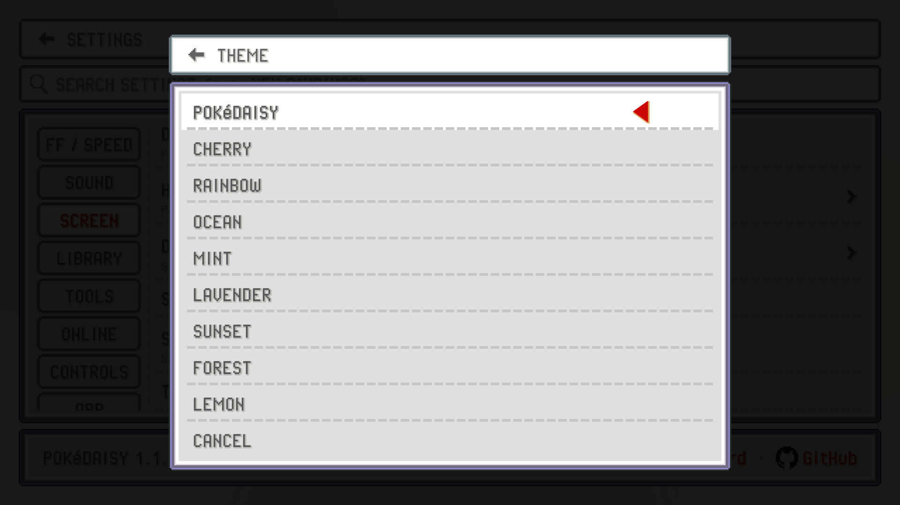

The top screen is wider than a GBA, so there's a choice to make about the space around the game. You can keep the GBA's own shape, stretch it, or let PokeDaisy draw more of the world into the gaps. On top of that you can run the picture through a filter, put a frame around it and switch the app's windows to a dark look.

Everything on this page is in the `SCREEN` group of Settings, on both screens: the top screen's Settings (from the library) and the companion's `SETTINGS` tab. `STATUS BAR`, `SHADERS`, `OVERLAY` and `LIGHT COMPANION` are on its `DISPLAY OPTIONS` page. A change made on the companion shows on the game straight away.

## Aspect: how the game fills the screen

`ASPECT` has three choices:

| Choice | What you get |
| --- | --- |
| `ORIGINAL` | The GBA's 3:2 picture, as big as it fits, with bars at the sides. This is the default. |
| `STRETCH` | The game stretched sideways to fill the screen. No bars, but everything looks a bit wider than it should. |
| `EXPAND` | The map drawn past the GBA's edges, so the whole screen is game with square pixels and nothing stretched. Only in the games that support it. |

On the top screen, `ASPECT` opens a preview: each choice is drawn as a little top screen, using your newest save state picture when there is one. Tap the one you want. On the companion it's a pick-list, and the game changes as soon as you pick.

## EXPAND: more of the map

With `EXPAND` you see more of the route around you instead of black bars. The strips beside the game aren't stretched or made up: they're rebuilt every frame from the game's own map, tiles and characters, so people walk in from the edges, water moves and the lighting matches. On a phone held upright the extra map goes above and below the game instead.

A few things worth knowing:

- **Battles are wide too.** The battle scenery carries on past the edges, and Pokémon, trainers and health boxes slide in from off screen. Some hacks only draw their battle scenes as wide as the screen; there the scene is mirrored out from its edges so it still flows on. The dark band behind the text and the battle menu runs right across.
- **Weather and caves work.** Fog, ash and rain reach the screen's edges, and a dark cave stays dark around your light.
- **Menus and the title screen** can't be extended, so there the strips glow softly with the colours at the game's edges, and fade back into the map when you return to it.
- **Supported games:** FireRed, LeafGreen, Emerald, Ruby and Sapphire (every language and revision), plus Unbound, Radical Red, Lazarus, SoulGold, Heart and Soul, Gaia, Odyssey, Amethyst 1.3.0, Glazed, Seaglass, Emerald Imperium, Emerald Legacy, Emerald Rogue, Too Many Types 2, Recharged Yellow, Super Mariomon, Ultra Violet, FireRed Rocket Edition, Ash Gray, Ghost Grey, Elite Redux, Sword and Shield Ultimate Plus, GS Chronicles and Celia's hack.
- **DS games:** Platinum, HeartGold, SoulSilver and Black. Their 3D world goes on past the screen, and so do their battles: Black's whole battle scene, sky, ground and all, and the others' battle backgrounds with the health boxes carried to the edges.
- **On the Game Boy:** Yellow (the English cart) and Crystal have it too. The town or route goes on past the small screen, with the people standing in it, and zoom and looking around work the same way. People in the next town or route show up in the strips before you cross over. Text boxes, the start menu, the save prompt and the options screen keep the map around them. Battles and the other menu screens aren't widened: the strips there are plain, in the colours along the screen's sides (white in most of them, Yellow's trainer card too; black beside a screen whose top part is black).

`EXPAND` is tagged `BETA` in Settings: it works in every game listed above, but it isn't perfect yet, and now and then you may spot something at the edges that the game itself doesn't show. If you do, [tell us](https://pokedaisy.com/feedback/) where it happened.

In a game that doesn't support it yet, `EXPAND` shows as `ORIGINAL` and the companion's pick-list tags it `NOT YET`. You can leave it on: it kicks in for every game that has it.

> [!NOTE]
> On plorpOS, where PokeDaisy runs as a core, the picture is sized to the screen instead: see [Linux handhelds](linux.md#the-picture-in-the-launcher).

> [!TIP]
> The first time you start a game that supports it, PokeDaisy may ask whether to turn `EXPAND` on (`TURN ON` or `NOT NOW`). Either answer is fine, and you can change it any time under `ASPECT`.

### Zoom and looking around

With `EXPAND` on, the `ZOOM` hotkey steps the view out so you see further around you. It's R3 (clicking the right stick) by default, or `C` on a keyboard; you can move it to any button under `HOTKEYS` (see [Controls](controls.md)). Battles, conversations and menus ease back in by themselves, so text is never tiny. Each game keeps the zoom you picked: open it again and, once you're back on the field, the view eases out to it. If you'd rather keep your zoom through conversations, signs and menus, turn `AUTO ZOOM IN` off in Settings; battles still ease in, and so do the party and bag screens you open from one.

The **right stick** looks around. Push it and the view moves; let go and it stays put until you walk, then glides back to you. Hold it while you walk and the camera looks ahead in that direction, keeping your character on screen.

## DS resolution: sharper 3D

The DS games (Platinum, HeartGold and SoulSilver) draw their world in 3D, and the DS drew it small: 256 by 192 pixels, so on a big screen the edges look jagged. `DS RESOLUTION` draws that 3D at more pixels instead.

| Choice | What you get |
| --- | --- |
| `ORIGINAL` | The DS's own picture, pixel for pixel. This is the default. |
| `2x` to `8x` | The 3D drawn that many times sharper by your device's graphics chip. `4x` is about as sharp as a 1080p screen can show; `6x` and `8x` go past it, which smooths the edges even more. |

Text, menus and anything the game draws flat keep their own pixels, so they look the same at every choice.

With `2x` or more and `ASPECT` on `EXPAND`, the world past the screen's edges is drawn together with the screen in one go, just as sharp, and the strips stay smooth as you walk. Zoomed far out, the 3D is drawn a little less sharp to keep things quick; it's small on screen then anyway.

A few things worth knowing:

- **It works the graphics chip harder.** If a game slows down or your device runs warm, pick a lower choice.
- **Not every device can do it.** It needs a fairly recent graphics chip (OpenGL ES 3.2, which most handhelds of the last few years have). On a device without one the row shows `N/A` and the game uses `ORIGINAL`.
- **Some shaders step aside.** `SMOOTHING` and `UNLIT SCREEN` work on the DS's own pixels, so they're off at `2x` and up. `FILTER` and `GBA COLORS` still apply.
- On the companion, the row only shows while a DS game is running, and a change shows on the game straight away.

## Status bar

`STATUS BAR` adds a thin strip with the game's name, where you are, your money, the time and the battery. It's handy when the game is full screen and you can't see the device's own clock.

| Choice | Where it goes |
| --- | --- |
| `OFF` | No bar (the default). |
| `GAME` | Across the top of the game, exactly as wide as it. The game shrinks a little to make room. |
| `COMPANION` | Over the companion's tabs on the bottom screen, so the game keeps its full size. |

The clock follows your device's 12 or 24 hour setting. Money shows for the games where PokeDaisy can read it.

## Shaders

`SHADERS` opens a page of effects for how the game is drawn. They stack: you can have smoothing, the GBA's colours, the unlit screen and a filter all at once.

### Filter

`FILTER` changes on every tap, so you can tap through them and watch the game change (from the companion it's instant; from the top screen the game picks it up when you go back to it).

| Filter | Look |
| --- | --- |
| `NONE` | Clean pixels (the default). |
| `LCD` | The GBA's fine pixel grid. |
| `LCD PAPER` | A softer grid over a faint paper texture, like an unlit handheld screen. |
| `SCANLINES` | Dark lines between the rows, like an old TV. |
| `CRT` | Soft glowing beams and a colour mask, like a tube TV up close. |

`GRID` sets how strong the grid is for `LCD` and `LCD PAPER`: `SOFT`, `MEDIUM` (the default) or `STRONG`. It's greyed out for the other filters.

### Smoothing

`SMOOTHING` rounds off the blocky edges of the pixel art before any filter is drawn. It's for people who like a cleaner, painted look over sharp pixels. Tap to step through:

- `OFF`: the original pixels (the default).
- `xBRZ`: sharp, the cleanest edges.
- `xBR`: rounder and softer.
- `SCALEFX`: the most even outlines.

Smoothing only applies to the game, never to the companion. On devices whose graphics chip can't run it, the row shows `N/A`.

### GBA COLORS

The GBA's own screen was darker and less saturated than a modern one, and the games' colours were picked for it. `GBA COLORS` shows them the way they looked back then. It works with any filter. Off by default.

### UNLIT SCREEN

The first GBA had no light behind its screen. Light from the room went in through the screen and bounced off a dull grey green backing, so white parts of the picture showed that backing instead of glowing, and dark pixels cast a faint shadow onto it, down and to the right. `UNLIT SCREEN` draws the game that way. It's softer on the eyes than bright white, and it pairs well with `GBA COLORS` and the `LCD` filter. Off by default.

### On the companion too

`ON COMPANION` (on by default) puts the same `FILTER` and `GBA COLORS` (not `UNLIT SCREEN`) over the companion screen and the status bar, so both screens match. The grid is sized to the game's pixels, so the lines line up with the top screen's. This needs Android 13 or newer; on older devices the companion keeps its plain look.

## Overlay: a frame around the game

`OVERLAY` draws a frame around the game, filling the space a 3:2 picture leaves. PokeDaisy has two of its own:

- `DAISY`: PokeDaisy's blue with a dot grid and the flower mark in the margin.
- `BEZEL`: a plain dark surround.

They're drawn at the game's own pixel size and the game is shown at a whole-number scale inside them, so everything stays crisp (the game is a little smaller than without a frame).

### Your own RetroArch overlays

If you already use overlays in RetroArch, you can bring them over. On the top screen, open Settings > `OVERLAY` and tap `IMPORT FILE`. You can pick:

- a RetroArch overlay `.cfg` together with its PNG image,
- a `.zip` with overlays in it,
- or any PNG with a see-through hole where the screen goes.

PokeDaisy finds where the game goes from the `.cfg`, or from the see-through part of the PNG. A PNG with no hole is used as a background behind the game. If a `.cfg` arrives without its picture, it asks you to `PICK THE IMAGE`. A pack with both landscape and portrait versions uses whichever fits the screen.

Imported overlays are listed under `IMPORTED`. Tap one to use it, or use `REMOVE` to delete them. Once imported, you can pick them from the companion's `OVERLAY` list too.

> [!NOTE]
> PokeDaisy doesn't ship or link any third-party overlays. Most console borders carry the console maker's logo, so bring the ones you already have.

Overlays are switched off on a phone held upright, where the game sits across the top. With `STRETCH`, the game fills the overlay's screen area.

## Dark mode

`DARK MODE` turns the app's white and grey windows into dark slate ones with light text, on both screens at once. Nice at night or in a dim room. Each tap on the row moves to the next choice, so you see each one right away:

- `OFF`: the light windows (the default).
- `ON`: always dark.
- `AUTO`: follows your device's dark theme setting.

The game's own art stays as it is: party slots, the map, the trainer card and battle buttons keep the game's colours. Backgrounds dim behind them.

## Theme

`THEME` picks the backdrop behind the top screen's library, Settings and setup. `POKéDAISY` (the default) is the website's light page with soft blobs and floating logos. The others are colour themes from the games: `FIRERED`, `LEAFGREEN`, `EMERALD`, `RUBY`, `SAPPHIRE`, `PLATINUM`, `HEARTGOLD` and `SOULSILVER`.

The theme only changes the top screen outside a game. While you play, the companion always uses the running game's own look.

## FPS / CPU

`FPS / CPU` shows a small readout in the game's top-left corner: how many frames the game ran in the last second and how much of the CPU PokeDaisy is using. It should read about 60 at normal speed.

Tap the readout to open a longer panel with frame times, late frames, the screen's refresh and pacing, audio underruns, battery temperature, thermal state and memory. It's useful when a game feels choppy; see [Troubleshooting](troubleshooting.md#the-game-feels-choppy-or-the-device-runs-hot).

## Light companion for slow devices

On a slower handheld, the companion can keep the device so busy that your button presses reach the game late: you press a button and nothing happens for a moment, often right after `FIGHT` while the companion draws your moves. `LIGHT COMPANION` makes the companion easier on the device:

- it redraws only when something it shows has changed, and at most twice a second (a battle's menu changing still shows at once);
- its animations are off: the bouncing party icons, the blinking map cursor, sliding tabs and the battle buttons' fade;
- `ON COMPANION` under `SHADERS` is off, so no filter is drawn over the companion.

`AUTO`, the default, turns it on by itself on a device that looks slow, and on any device once your buttons have come late a few times, which it remembers from then on. The line under the setting says what `AUTO` decided. `ON` and `OFF` choose for yourself.

## Other screen settings

- `SWAP SCREENS` (devices with two screens) puts the game on the second screen and the companion on the main one, for devices whose main display is the bottom one. See [Devices](devices.md).
- `COMPANION` (single-screen devices held upright) puts the companion `AT BOTTOM` of the screen or `UNDER GAME`. See [Devices](devices.md).
